# Financial Econometrics Practical Exam 2026

**Student number:** 23854936

This is the main document for the financial econometrics practical: it
contains and describes all code used in each question.

# Setup

``` r
for (q in paste0("Question", 1:4)) {
  Texevier::create_template(directory = "Questions", template_name = q, open_project = FALSE)
}
```

# Question 1: Exploring Risk and Uncertainty

All functions for this question live in `Questions/Question1/code/`. The
write-up (pdf) is `Questions/Question1/Question1.Rmd`.

``` r
pacman::p_load(tidyverse, rugarch, tbl2xts, RcppRoll, zoo, broom, xtable)

list.files("Questions/Question1/code/", full.names = TRUE) %>%
    .[grepl("[.]R$", .)] %>%
    walk(~source(.))
```

## Part A: Has local volatility increased, and does it mirror the global experience?

**Approach.** No single measure can show both whether local volatility
has increased and whether it mirrors the global experience, so I build
the evidence in layers. I start with realised volatility, which is
model-free and shows how local and global markets have actually moved. I
then fit GARCH models to capture what realised volatility misses: how
long volatility shocks persist and whether bad news raises volatility
more than good news. Finally, because the seminar’s claim is about
*causes*, I relate local volatility to offshore uncertainty measures and
to rand volatility to separate imported from home-grown risk.
Throughout, I prefer simple methods backed by robustness checks, so that
each conclusion rests on more than one piece of evidence.

### Data

Local index returns start in 2015, so all comparisons run from January
2015 to September 2026. Local series are in Rands; global indexes are
total return series in USD, which I convert to daily returns.

``` r
Idx_Daily            <- read_rds("data/Index_Returns_Daily.rds")
MSCI                 <- read_rds("data/MSCI_Indexes.rds")
Global_Idx           <- read_rds("data/Global_Indexes_USD.rds")
Uncertainty_Indexes  <- read_rds("data/Econ_Uncertainty_Indexes.rds")
Implied_Vol          <- read_rds("data/Implied_Vol_Indexes.rds")
Local_Cncy_Vol_Index <- read_rds("data/LCL_Currency_Vol_Index.rds")
Gl_Cncy_Vol_Index    <- read_rds("data/Global_Currency_Vol_Index.rds")
Commods              <- read_rds("data/Commodities.rds")

# Local (Capped SWIX, Top 40, Mid, Small) + global (ACWI, EM, S&P 500, Euro Stoxx, Nikkei)
Eq_Returns <- Q1A_Equity_Returns(Idx_Daily, MSCI, Global_Idx)
Eq_Returns %>% count(Region, Name) %>% knitr::kable()
```

| Region       | Name          |    n |
|:-------------|:--------------|-----:|
| Global (USD) | Euro Stoxx 50 | 3016 |
| Global (USD) | MSCI ACWI     | 3064 |
| Global (USD) | MSCI EM       | 3065 |
| Global (USD) | Nikkei 225    | 2868 |
| Global (USD) | S&P 500       | 2952 |
| Local (ZAR)  | Capped SWIX   | 2935 |
| Local (ZAR)  | Mid Caps      | 2935 |
| Local (ZAR)  | Small Caps    | 2935 |
| Local (ZAR)  | Top 40        | 2935 |

Insights from data exploration:

- The global and Europe policy uncertainty (EPU) indexes are **monthly**
  values repeated on every day, so any comparison with EPU is done at
  monthly frequency.
- The SAVI (USDZAR vol) index is quoted as a decimal (e.g. 0.15) instead
  of a percentage on 109 days (mostly Mar-Jun 2021), a units error that
  I rescale in `Q1A_Uncertainty_Levels()`.
- The S&P 500 TRI carries US holidays forward as flat days, which I
  remove.

To give the time-series plots context, I shade five market events. They
are deliberately split into two SA-specific political shocks and three
global shocks, because comparing how local vs global volatility reacted
to each type is a simple test of whether local volatility is home-grown
or imported (see the event study below).

``` r
Q1_Events %>% knitr::kable()
```

| Label                    | Start      | End        | Type   |  ID |
|:-------------------------|:-----------|:-----------|:-------|----:|
| Nenegate                 | 2015-12-09 | 2015-12-31 | Local  |   1 |
| Cabinet reshuffle & junk | 2017-03-30 | 2017-04-28 | Local  |   2 |
| COVID-19 crash           | 2020-02-20 | 2020-06-30 | Global |   3 |
| Ukraine war & oil shock  | 2022-02-24 | 2022-06-30 | Global |   4 |
| US tariff shock          | 2025-04-02 | 2025-04-30 | Global |   5 |

### Realised volatility

Rolling 63-day standard deviation of daily returns, annualised with
$`\sqrt{252}`$. I use 63 trading days (about one quarter) as a
compromise: a shorter window (e.g. 21 days) is very noisy, while a
longer one (e.g. 252 days) smooths away exactly the short volatility
episodes I want to detect.

``` r
Roll_Vols <- Roll_Vol(Eq_Returns, Window = 63)
Plot_Roll_Vol(Roll_Vols)
```

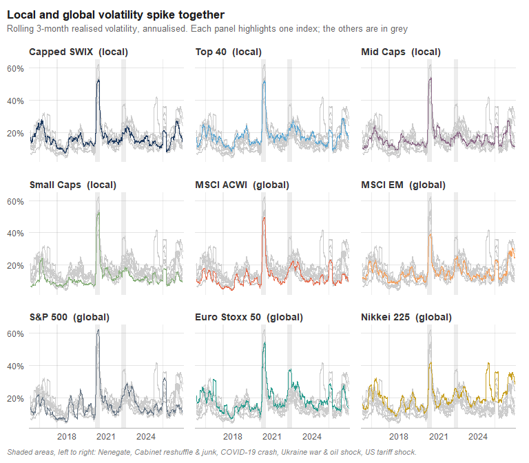<!-- -->

``` r
Cal_Vols <- Calendar_Vol(Eq_Returns)
Plot_Calendar_Vol(Cal_Vols)
```

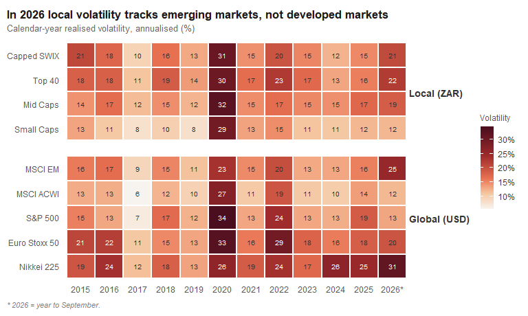<!-- -->

**Interpretation:** The COVID-19 crash dominates every series (local vol
peaks above 50%), but outside 2020 the picture is one of short spikes
rather than a steady upward trend. The calendar view highlights a recent
divergence: in 2026 (to September) Capped SWIX vol is about 21%, far
above MSCI ACWI (about 12%) and the S&P 500, and much closer to MSCI EM
(about 25%). So in the most recent period, local volatility mirrors the
*emerging market* experience rather than the developed market one. Small
caps are consistently the least volatile local index, which reflects
their low liquidity (stale prices smooth measured volatility) rather
than lower true risk.

To answer “has vol increased?” more formally, I compare average rolling
vol before and after 2020, and the share of days each index spends above
its own long-run 80th percentile of vol. Using each index’s *own*
percentile makes “high vol” a relative definition, so a naturally more
volatile market (e.g. the Nikkei) is not automatically flagged as
high-vol all the time. The second table drops the COVID crash (mid-Feb
to July 2020) to check that the result is not driven by one outlier
episode.

``` r
Vol_Regime_Table(Roll_Vols) %>% knitr::kable(digits = 3)
```

| Region | Name | AvgVol_Pre | AvgVol_Post | VolChange | HighVolDays_Pre | HighVolDays_Post |
|:---|:---|---:|---:|---:|---:|---:|
| Global (USD) | Nikkei 225 | 0.171 | 0.229 | 0.057 | 0.097 | 0.272 |
| Global (USD) | S&P 500 | 0.126 | 0.176 | 0.049 | 0.114 | 0.261 |
| Global (USD) | Euro Stoxx 50 | 0.161 | 0.208 | 0.047 | 0.091 | 0.277 |
| Global (USD) | MSCI ACWI | 0.104 | 0.141 | 0.037 | 0.116 | 0.260 |
| Global (USD) | MSCI EM | 0.137 | 0.169 | 0.033 | 0.100 | 0.271 |
| Local (ZAR) | Small Caps | 0.098 | 0.141 | 0.043 | 0.066 | 0.295 |
| Local (ZAR) | Mid Caps | 0.139 | 0.179 | 0.039 | 0.099 | 0.271 |
| Local (ZAR) | Top 40 | 0.159 | 0.190 | 0.031 | 0.137 | 0.245 |
| Local (ZAR) | Capped SWIX | 0.154 | 0.175 | 0.022 | 0.151 | 0.235 |

``` r
Vol_Regime_Table(Roll_Vols, Exclude = as.Date(c("2020-02-15", "2020-07-31"))) %>% knitr::kable(digits = 3)
```

| Region | Name | AvgVol_Pre | AvgVol_Post | VolChange | HighVolDays_Pre | HighVolDays_Post |
|:---|:---|---:|---:|---:|---:|---:|
| Global (USD) | Nikkei 225 | 0.171 | 0.222 | 0.051 | 0.120 | 0.261 |
| Global (USD) | Euro Stoxx 50 | 0.161 | 0.194 | 0.033 | 0.134 | 0.250 |
| Global (USD) | S&P 500 | 0.126 | 0.156 | 0.030 | 0.157 | 0.232 |
| Global (USD) | MSCI EM | 0.137 | 0.161 | 0.024 | 0.126 | 0.256 |
| Global (USD) | MSCI ACWI | 0.104 | 0.127 | 0.022 | 0.165 | 0.227 |
| Local (ZAR) | Small Caps | 0.098 | 0.125 | 0.027 | 0.069 | 0.299 |
| Local (ZAR) | Mid Caps | 0.139 | 0.163 | 0.023 | 0.102 | 0.274 |
| Local (ZAR) | Top 40 | 0.159 | 0.176 | 0.017 | 0.156 | 0.233 |
| Local (ZAR) | Capped SWIX | 0.154 | 0.160 | 0.007 | 0.169 | 0.224 |

**Interpretation:** Including COVID, every index is more volatile after
2020 (Capped SWIX average vol rises from 15.4% to 17.5%). The robustness
check changes the story, though: excluding the COVID crash, Capped SWIX
average vol barely moves (15.4% to 16.0%), while the share of days in a
high-vol state still rises from 17% to 22%. Local volatility has
therefore not shifted to a permanently higher *level*; instead,
volatility *episodes* have become more frequent. The rise is larger for
Mid and Small Caps (high-vol days more than quadrupling for Small Caps,
from about 7% to 30%) and larger in developed markets (S&P 500 +3.0pp,
Nikkei +5.1pp excluding COVID) than for the Capped SWIX itself.

### Event study: home-grown or imported volatility?

For each shaded event: how much did rolling vol rise (peak during the
event + 30 days, minus the level just before it)? If SA-specific events
lift local vol more than global vol, while global events lift both,
local vol is a mix of home-grown and imported shocks, and the size of
each tells us which matters more.

``` r
Event_Vol_Table(Roll_Vols, Q1_Events, Names = c("Capped SWIX", "MSCI EM", "MSCI ACWI")) %>%
    knitr::kable(digits = 3)
```

| Event                    | Type   | Capped SWIX | MSCI EM | MSCI ACWI |
|:-------------------------|:-------|------------:|--------:|----------:|
| Nenegate                 | Local  |       0.058 |   0.030 |     0.019 |
| Cabinet reshuffle & junk | Local  |       0.002 |   0.014 |     0.011 |
| COVID-19 crash           | Global |       0.393 |   0.261 |     0.417 |
| Ukraine war & oil shock  | Global |       0.077 |   0.112 |     0.077 |
| US tariff shock          | Global |       0.086 |   0.090 |     0.103 |

**Interpretation:** Nenegate was a home-grown shock: local vol rose by
about 5.8 percentage points, roughly three times the rise in MSCI ACWI
(1.9pp). The 2017 cabinet reshuffle and junk downgrade, by contrast,
barely moved local vol (+0.2pp), which suggests the downgrade had
largely been priced in by the time it happened. The three global shocks
lifted local vol by about as much as global vol (COVID: 39pp locally vs
42pp for ACWI; Ukraine/oil: 7.7pp for both; tariffs: 8.6pp vs 10.3pp).
The *large* volatility episodes in the local market are therefore
imported, while local political shocks have been smaller and
shorter-lived.

### Does local move with global? Rolling correlation

Weekly returns, 52-week window. Weekly data is used because the JSE
closes before the US market opens, which biases daily correlations with
US-heavy indexes downwards (a US move on day *t* only shows up in JSE
prices on day *t+1*).

``` r
Roll_Cors <- Roll_Cor_Weekly(Eq_Returns, LocalName = "Capped SWIX",
                             GlobalNames = c("MSCI ACWI", "MSCI EM", "S&P 500"))
Plot_Roll_Cor(Roll_Cors)
```

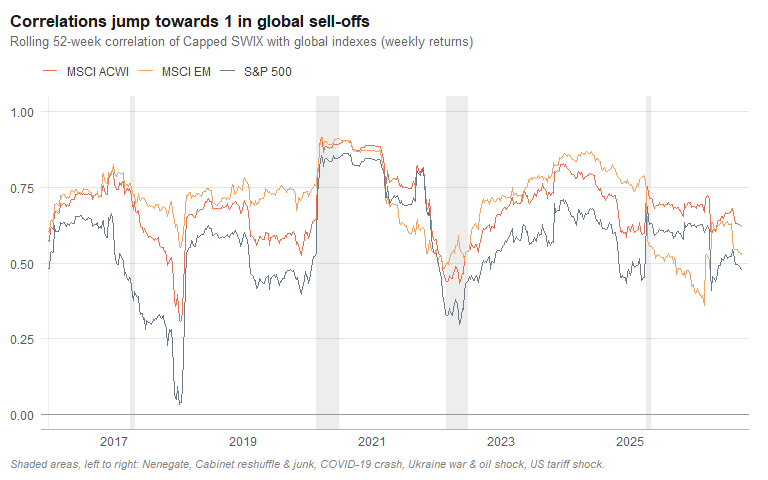<!-- -->

**Interpretation:** The Capped SWIX is strongly linked to global
markets, with an average correlation of about 0.68 with MSCI ACWI and
0.71 with MSCI EM. Correlations are not stable, however: they jumped to
roughly 0.9 during the COVID crash, exactly when diversification was
needed most, and fell sharply in quieter periods (the correlation with
the S&P 500 dropped close to zero in late 2017). This “correlations go
to one in a crisis” pattern is important for Part B: offshore
diversification gives the least protection in global sell-offs. The
recent fall in the correlation with MSCI EM (to about 0.5) suggests that
part of the 2026 volatility is SA- or region-specific.

### Conditional volatility: GARCH

First, I confirm there is volatility clustering (ARCH effects), then
compare GARCH specifications, then extract the conditional volatility
from the preferred model.

``` r
# Ljung-Box on squared returns: H0 = no ARCH effects
ARCH_Test_Table(Eq_Returns, Names = c("Capped SWIX", "MSCI ACWI", "MSCI EM")) %>% knitr::kable(digits = 4)
```

| Name        |  LB_Stat | P_Value |
|:------------|---------:|--------:|
| Capped SWIX | 2616.650 |       0 |
| MSCI ACWI   | 2901.016 |       0 |
| MSCI EM     | 1084.319 |       0 |

The test statistics are very large (over 1,000 for all three series)
with p-values of essentially zero, so I reject the null of no ARCH
effects: large moves tend to follow large moves. A constant-variance
model would therefore misstate risk, which justifies modelling
volatility with GARCH.

For the error distribution I use the skewed Student-t, because equity
returns are fat-tailed (more extreme days than a normal distribution
allows) and negatively skewed (crashes are larger than rallies). An
AR(1) mean is included, as in Practical 6, to absorb any small
first-order autocorrelation in returns.

``` r
# Lower AIC / BIC = better fit
Garch_Model_Compare(Eq_Returns, Names = c("Capped SWIX", "MSCI ACWI", "MSCI EM")) %>% knitr::kable(digits = 4)
```

| Name        | Model    |     AIC |     BIC |
|:------------|:---------|--------:|--------:|
| Capped SWIX | sGARCH   | -6.3950 | -6.3808 |
| Capped SWIX | gjrGARCH | -6.4135 | -6.3972 |
| Capped SWIX | eGARCH   | -6.4184 | -6.4021 |
| MSCI ACWI   | sGARCH   | -7.0883 | -7.0745 |
| MSCI ACWI   | gjrGARCH | -7.1269 | -7.1112 |
| MSCI ACWI   | eGARCH   | -7.1339 | -7.1181 |
| MSCI EM     | sGARCH   | -6.5318 | -6.5181 |
| MSCI EM     | gjrGARCH | -6.5548 | -6.5390 |
| MSCI EM     | eGARCH   | -6.5530 | -6.5373 |

The asymmetric models (gjrGARCH, eGARCH) beat the standard GARCH for all
three series. eGARCH has a marginally lower AIC for some series, but the
differences are in the third decimal place, so the choice between the
two asymmetric models makes little practical difference. I use the
GJR-GARCH(1,1) because its leverage parameter ($`\gamma`$) is easy to
interpret: it measures how much more volatility rises after a negative
shock than after a positive one.

``` r
Garch_Out <- Garch_Fit_Sigma(Eq_Returns, Names = c("Capped SWIX", "MSCI ACWI", "MSCI EM"), Model = "gjrGARCH")

Garch_Out$Params %>% knitr::kable(digits = 4)   # persistence close to 1 = long volatility memory
```

| Name        | alpha1 |  beta1 | gamma1 | Persistence | HalfLife_days |
|:------------|-------:|-------:|-------:|------------:|--------------:|
| Capped SWIX | 0.0017 | 0.9033 | 0.1323 |      0.9689 |       21.9696 |
| MSCI ACWI   | 0.0000 | 0.8651 | 0.2324 |      0.9758 |       28.3162 |
| MSCI EM     | 0.0134 | 0.8477 | 0.1810 |      0.9491 |       13.2767 |

``` r
Plot_Garch_Sigma(Garch_Out$Sigma)
```

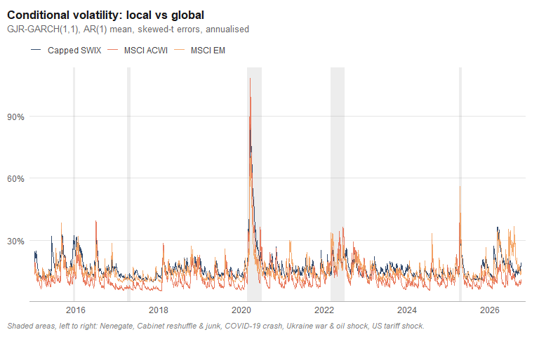<!-- -->

**Interpretation:** Two results stand out. First, the symmetric shock
term $`\alpha`$ is close to zero for all three indexes while the
leverage term $`\gamma`$ is large (0.13 locally, 0.23 for ACWI):
volatility reacts to *negative* shocks but barely to positive ones. This
is the classic leverage effect, and it means volatility episodes are
triggered by sell-offs. Second, persistence is high (about 0.97 for the
Capped SWIX), so a volatility shock has a half-life of about 22 trading
days (one month). Local shocks fade faster than shocks to MSCI ACWI
(about 28 days) but slower than shocks to MSCI EM (about 13 days). The
conditional volatility plot confirms the realised-vol picture: the local
and global series spike at the same times.

### What drives local volatility? Offshore uncertainty

Monthly panel of local and global GARCH vol, implied vol (VIX, V2X,
VXEEM), policy uncertainty (EPU), US bond vol (MOVE), Brent oil realised
vol, and FX vol (SAVI for USDZAR, JPM global FX vol). I work at monthly
frequency because the global EPU index only updates monthly, and monthly
averages also filter out day-to-day noise. In the plots, all series are
standardised (z-scores) so that measures on very different scales
(e.g. EPU around 100-600 vs VIX around 10-80) can be compared on one
axis.

``` r
Unc_Levels <- Q1A_Uncertainty_Levels(Uncertainty_Indexes, Implied_Vol, Local_Cncy_Vol_Index,
                                     Gl_Cncy_Vol_Index, Commods)
Monthly_Panel <- Q1A_Monthly_Panel(Garch_Out$Sigma, Unc_Levels)

Plot_Drivers_Z(Monthly_Panel)
```

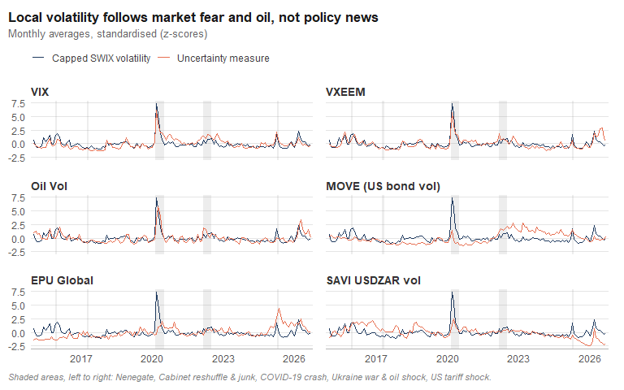<!-- -->

``` r
Plot_Cor_Heatmap(Monthly_Panel)
```

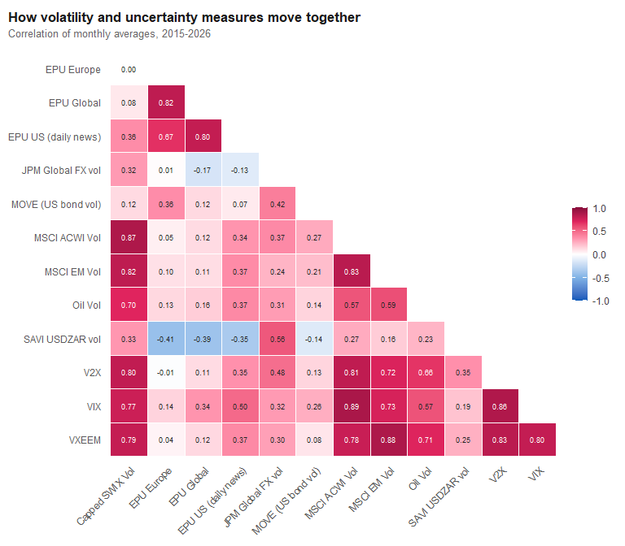<!-- -->

**Interpretation:** Local volatility moves closely with *market-based*
measures of risk: global equity volatility (0.87 with MSCI ACWI vol,
0.82 with MSCI EM vol), implied volatility (about 0.8 with VIX, V2X and
VXEEM) and oil volatility (0.70). By contrast, the *news-based* policy
uncertainty indexes have almost no correlation with local volatility
(0.08 for global EPU, 0.00 for Europe). Policy uncertainty therefore
seems to matter for local equities only once it turns into a shock to
global risk appetite or to oil prices. It should be noted that SAVI is
negatively correlated with the EPU indexes (about -0.4), which is more
likely a trend effect (EPU trended up while rand vol trended down) than
a meaningful economic relationship.

Finally, a simple regression of local (Capped SWIX) GARCH vol on the
offshore measures. All variables are standardised, so each coefficient
reads as “a one standard deviation rise in X goes with a $`\beta`$
standard deviation rise in local vol”. Model 2 adds local currency vol
(SAVI) to gauge whether it explains anything beyond the offshore
drivers.

``` r
Driver_Regs <- Q1A_Driver_Regressions(Monthly_Panel)
Driver_Regs$Coefs %>% knitr::kable(digits = 3)
```

| term               | estimate | std.error | statistic | p.value | Model           |
|:-------------------|---------:|----------:|----------:|--------:|:----------------|
| VIX                |    0.637 |     0.058 |    10.902 |   0.000 | Offshore only   |
| EPU.Global         |   -0.189 |     0.048 |    -3.980 |   0.000 | Offshore only   |
| MOVE..US.bond.vol. |   -0.072 |     0.046 |    -1.548 |   0.124 | Offshore only   |
| Oil.Vol            |    0.374 |     0.055 |     6.837 |   0.000 | Offshore only   |
| VIX                |    0.621 |     0.061 |    10.202 |   0.000 | Offshore + SAVI |
| EPU.Global         |   -0.164 |     0.055 |    -2.991 |   0.003 | Offshore + SAVI |
| MOVE..US.bond.vol. |   -0.062 |     0.047 |    -1.321 |   0.189 | Offshore + SAVI |
| Oil.Vol            |    0.365 |     0.055 |     6.604 |   0.000 | Offshore + SAVI |
| SAVI.USDZAR.vol    |    0.051 |     0.054 |     0.943 |   0.347 | Offshore + SAVI |

``` r
Driver_Regs$Fit %>% knitr::kable(digits = 3)
```

| Model           |    R2 |   N |
|:----------------|------:|----:|
| Offshore only   | 0.728 | 141 |
| Offshore + SAVI | 0.730 | 141 |

**Interpretation:** The offshore measures alone explain about 73% of the
monthly variation in local volatility. The VIX is the dominant driver (a
1 sd rise goes with a 0.64 sd rise in local vol), followed by oil
volatility (0.37 sd), and both are highly significant. MOVE is not
significant once the VIX is included. Global EPU enters with a
*negative* sign, but because EPU and the VIX are correlated, this
coefficient picks up the part of EPU that is *not* already reflected in
market fear, and should not be read as “uncertainty lowers volatility”.
Adding local currency volatility (SAVI) barely changes the fit (R² from
0.728 to 0.730) and is insignificant: once global fear and oil are
accounted for, the rand adds no extra information about equity
volatility.

### Part A conclusion

Local volatility has not moved to a permanently higher level since 2020,
but volatility episodes have become more frequent, and in 2025-26 local
volatility has tracked emerging markets rather than developed markets.
Most of these episodes are imported: global risk-off shocks and oil
volatility explain the bulk of the variation in local volatility, they
coincide with near-perfect correlation between local and global markets,
and volatility rises far more after losses than after gains. On the
seminar’s claim that oil price volatility and global policy uncertainty
are spilling into local equities, the evidence is mixed: oil volatility
clearly feeds through, but policy uncertainty only seems to matter once
it turns into global market fear (a higher VIX). For a local equity
fund, the practical takeaway is that the risk worth protecting against
is a global sell-off rather than a rand shock, which is the lens I use
to evaluate SafeCore in Part B.

**Limitations.** The regressions show associations, not causal effects.
Monthly volatility measures are persistent, so the residuals are likely
autocorrelated and the OLS standard errors understated; the strong
t-statistics on the VIX and oil remain convincing, but the borderline
terms (EPU, MOVE) should be read with caution. Finally, local volatility
is measured in rand and global volatility in US dollars, so part of any
gap between them reflects the currency rather than the equity market
itself.

## Part B: Does SafeCore navigate volatility effectively?

**Approach.** SafeCore is built without any explicit view on volatility,
so the question is whether it nonetheless behaves like a risk ballast,
and if not, why. I first establish *whether* there is a problem, by
looking at how the fund behaves when markets fall (not just its average
volatility), using a rebuilt Low Vol index as a reference for what a
true ballast looks like. Afterwhich, I find *where* its volatility comes
from, since a stock’s share of risk can differ greatly from its weight.
Finally, I build my own momentum and low-volatility scores and combine
them with the third party’s into portfolio-level factor exposures, to
explain *why* the fund behaves as it does. The Capped SWIX (J433) is the
benchmark throughout.

### Data and portfolio construction

``` r
Stock_Rets    <- read_rds("data/Stock_Returns_Daily.rds")
Index_Const   <- read_rds("data/Index_Constituents.rds")
SafeCore      <- read_rds("data/SafeCore.rds")
Factor_Scores <- read_rds("data/Factor_Scores.rds")
Hedge_Plays   <- read_rds("data/Currency_Hedge_Plays.rds")
STeFI         <- read_rds("data/STeFI_Index.rds")

SC_Holdings <- Q1B_SafeCore_Holdings(SafeCore, Index_Const)
```

Data checks prior construction:

- SafeCore’s holdings go back to 2007, but stock returns only start in
  2015, so the analysis runs from 2015.
- Holdings weights sum to 79-100% each month, which are rescaled to
  100%. In every month at least 94.7% of the fund’s weight has matching
  stock returns, so the rescaling only affects a few small holdings.
- A few holdings have no sector (e.g. Valterra Platinum, Pan African
  Resources). I fill these from the super-sector in the index
  constituent file rather than leaving them as “Other”, which would
  cloud resource risk.
- The stock return file contains some extreme daily moves (above 50%) in
  illiquid small caps. These matter for the factor scores, which is why
  those are capped (see below).

SafeCore’s daily returns are built with
`rmsfuns::Safe_Return.portfolio`: month-end weights are applied from the
next trading day (`lag_weights = TRUE`) and then drift with prices until
the next rebalance.

``` r
SafeCore_Rets <- Build_Portfolio(SC_Holdings, Stock_Rets, PortName = "SafeCore")
LowVol_Rets   <- Q1B_LowVol_Rebuild(Index_Const, Stock_Rets)        # quarterly rebalance
LowVol_Daily  <- Q1B_LowVol_Daily(Index_Const)                      # daily weights (check only)

B_Panel <- Q1B_Return_Panel(SafeCore_Rets, LowVol_Rets, Idx_Daily)
```

The Low Vol index (STXLVLJ433) only has returns from 2024, but its
constituents and weights are available from August 2020. I rebuild it
with weights reset at the end of March, June, September and December.
Before relying on the rebuild for 2020-2023, I check it against the
actual index where the two overlap:

``` r
Plot_LowVol_Check(LowVol_Rets, LowVol_Daily, Idx_Daily)
```

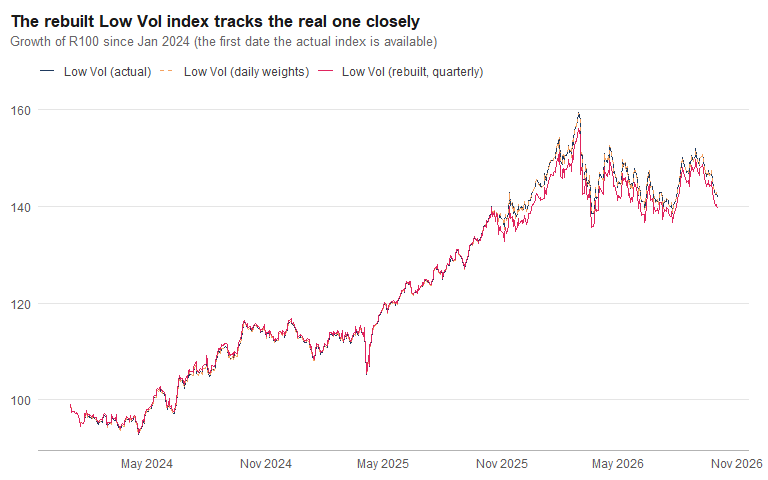<!-- -->

**Interpretation:** Over 2024-2026 the quarterly rebuild has a daily
correlation of 0.995 with the actual index and a tracking error of 1.4%
a year, ending about 2.7% below it after almost three years. Using the
daily (already drifted) weights in the file tracks even more closely
(correlation 0.999, tracking error 0.7%), because it picks up index
changes between quarterly rebalances. Either way the rebuild is accurate
enough to extend the Low Vol index back to 2020 as a ‘risk ballast’
benchmark.

### 1. Did SafeCore navigate volatility?

The scorecard summarises risk and return. I report it over the full
period, and over the period since September 2020 when the Low Vol index
is also available, so that every fund is judged on the same window. The
Sharpe ratio uses STeFI (the local cash index) as the risk-free rate.

``` r
Q1B_Scorecard(B_Panel %>% filter(Name != "Low Vol"), STeFI, as.Date("2015-01-01"), as.Date("2026-09-30")) %>%
    knitr::kable(digits = 3)
```

| Fund | Ann. return | Ann. vol | Sharpe | Max drawdown | Beta | Tracking error | Info. ratio |
|:---|---:|---:|---:|---:|---:|---:|---:|
| Capped SWIX | 0.087 | 0.178 | 0.102 | -0.417 | 1.000 | 0.000 | NA |
| SafeCore | 0.114 | 0.179 | 0.255 | -0.391 | 0.953 | 0.056 | 0.486 |
| Top 40 | 0.110 | 0.187 | 0.225 | -0.346 | 0.988 | 0.064 | 0.376 |

``` r
Q1B_Scorecard(B_Panel, STeFI, as.Date("2020-09-01"), as.Date("2026-09-30")) %>%
    knitr::kable(digits = 3)
```

| Fund | Ann. return | Ann. vol | Sharpe | Max drawdown | Beta | Tracking error | Info. ratio |
|:---|---:|---:|---:|---:|---:|---:|---:|
| Capped SWIX | 0.162 | 0.164 | 0.589 | -0.141 | 1.000 | 0.000 | NA |
| Low Vol | 0.124 | 0.151 | 0.388 | -0.147 | 0.876 | 0.051 | -0.740 |
| SafeCore | 0.176 | 0.169 | 0.655 | -0.185 | 1.003 | 0.039 | 0.357 |
| Top 40 | 0.161 | 0.181 | 0.528 | -0.172 | 1.062 | 0.049 | -0.026 |

**Interpretation:** SafeCore has been a good fund in return terms: since
2015 it returned 11.4% a year against 8.7% for the Capped SWIX, with an
information ratio of about 0.5 and a Sharpe ratio more than double the
benchmark’s. But it has not reduced risk: its volatility (17.9%) is the
same as the benchmark’s (17.8%), its beta is close to 1, and its maximum
drawdown (-39%) is only slightly smaller. Since 2020 its drawdown was
actually *deeper* than the benchmark’s (-18.5% vs -14.1%). The rebuilt
Low Vol index did what it is designed to do on volatility (15.1% vs
16.4%, beta 0.88), but at a large cost in return over this strong market
period, and without a smaller drawdown.

``` r
B_GDD <- Q1B_Growth_DD(B_Panel)
Plot_Growth_DD(B_GDD)
```

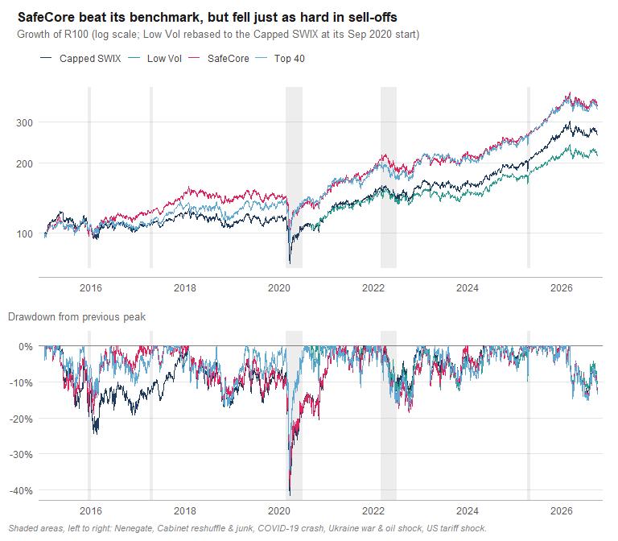<!-- -->

``` r
Plot_Vol_Ratio(Q1B_Vol_Ratio(B_Panel))
```

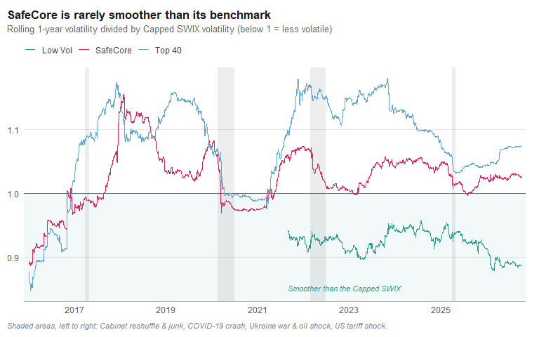<!-- -->

**Interpretation:** The growth chart shows where SafeCore’s
outperformance came from: it pulled ahead of the benchmark in 2016-2018
and again from 2020, and since 2020 it has tracked the Top 40 very
closely. The drawdown panel shows that in every major sell-off SafeCore
fell about as far as the market. The volatility ratio makes the point
directly: SafeCore was less volatile than the Capped SWIX in only about
a quarter of rolling one-year windows (mostly 2015-2016 and 2020), and
has been slightly more volatile since 2021. The rebuilt Low Vol index,
by contrast, was smoother than the benchmark in every window, typically
by about 8%.

To look at how each fund participates in market moves, I compute upside
and downside capture per calendar year: the fund’s average return on
days the benchmark rose (fell), divided by the benchmark’s average
return on those days. A good ballast captures less of the downside than
of the upside, which puts it above the dashed 45-degree line.

``` r
Plot_Capture(Q1B_Capture(B_Panel))
```

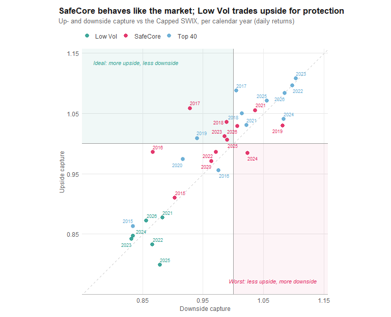<!-- -->

**Interpretation:** SafeCore’s points cluster tightly around (1, 1): in
most years it simply moves with the market, capturing roughly all of the
upside and all of the downside. Its best years (2016, 2017) sit in the
ideal quadrant, but 2019 and 2024 sit in the worst one. The Low Vol
index sits in the bottom-left: it captures only about 80-88% of both up
and down moves. That is the signature of a genuine low-beta strategy: it
reduces both sides symmetrically, rather than offering “free” downside
protection.

Next, stress tests: the cumulative return in each Part A event window
and in the five highest-VIX months that are not already inside an event
(so the same crisis is not counted twice).

``` r
Stress_Windows <- Q1B_Stress_Windows(Q1_Events, Implied_Vol, N_VIX = 5)
Plot_Stress(Q1B_Stress_Returns(B_Panel, Stress_Windows))
```

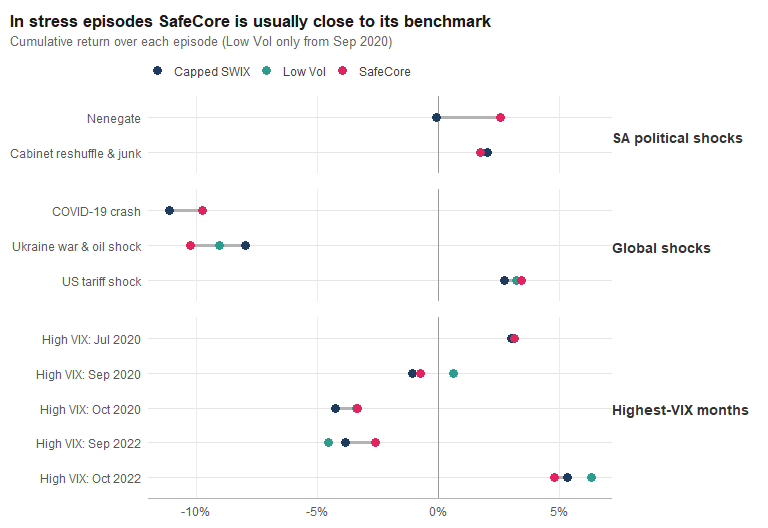<!-- -->

Finally, performance by volatility regime: each month is classified by
its average VIX into calm, normal and stressed terciles, and I compare
each fund’s return with the benchmark’s.

``` r
Plot_VIX_Regimes(Q1B_VIX_Regimes(B_Panel, Implied_Vol))
```

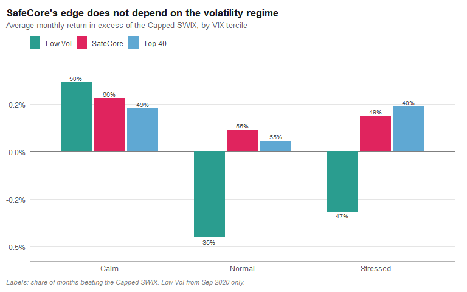<!-- -->

**Interpretation:** SafeCore did better than the benchmark in 7 of the
10 stress episodes, but usually by less than 1.5 percentage points, and
it did worse in the most relevant one for the seminar’s argument: the
2022 Ukraine war and oil shock (-10.2% vs -8.0%). Its excess return is
positive in all three VIX regimes (about +0.2% a month), and it beats
the benchmark in only about half of stressed months. In other words,
SafeCore’s edge is a steady stock-selection edge that does not come from
protection in turbulent markets. Interestingly, the Low Vol index
underperformed the benchmark in normal and stressed months since 2020, a
reminder that lower volatility does not guarantee better returns in
every stressed month.

### 2. Where does SafeCore’s volatility come from?

At each month-end I decompose the fund’s variance into each stock’s
contribution: with weights $`w`$ and covariance matrix $`\Sigma`$, stock
$`i`$ contributes $`w_i (\Sigma w)_i / w'\Sigma w`$, and the
contributions sum to 100%. Unlike the weight, this accounts for how
volatile each stock is *and* how it co-moves with the rest of the fund.
The covariance matrix uses the past year of daily returns and is shrunk
towards a structured target (Ledoit-Wolf, as in Practical 3): with about
40 stocks and 252 observations the sample covariance matrix is noisy,
and shrinkage makes the contributions more stable.

``` r
Risk_Contrib <- Q1B_Risk_Contrib(SC_Holdings, Stock_Rets)

Plot_Sector_Risk(Risk_Contrib)
```

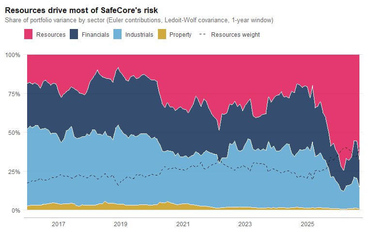<!-- -->

``` r
Plot_Weight_vs_Risk(Risk_Contrib, TopN = 10)
```

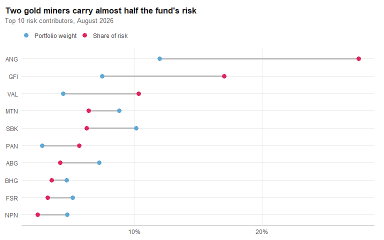<!-- -->

**Interpretation:** Resources are by far the main source of SafeCore’s
risk, and this has become more prevalent recently. In August 2026
resources made up 40% of the fund’s weight but 68% of its risk. Two gold
miners, AngloGold Ashanti (12% weight, 28% of risk) and Gold Fields (8%
weight, 17% of risk), account for almost half of the fund’s volatility,
and Valterra Platinum adds another 10%. Banks and industrials (Standard
Bank, Absa, FirstRand, MTN, Naspers) contribute less risk than their
weight: they act as diversifiers within the fund. The fund’s estimated
volatility (from the covariance matrix) is about 20% a year, above its
long-run average of about 18%.

Two structural features can amplify this: concentration and currency
exposure. Concentration is measured by the effective number of stocks,
$`1/\sum w_i^2`$ (equal to $`N`$ for an equally weighted portfolio). For
the currency profile I use the third party’s rand-hedge classification,
which is only available at the latest date, so this is a snapshot.

``` r
Plot_Conc_Hedge(Q1B_Effective_N(SC_Holdings, Index_Const),
                Q1B_Hedge_Profile(SC_Holdings, Index_Const, Hedge_Plays))
```

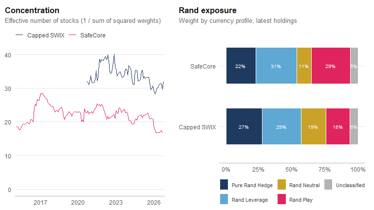<!-- -->

**Interpretation:** SafeCore behaves like a portfolio of about 17-22
equally weighted stocks, roughly half the effective breadth of the
Capped SWIX (about 30-40), and its concentration has increased in 2026.
Fewer effective bets means that a few stocks (here, the gold miners) can
dominate its risk. On currency, SafeCore holds fewer pure rand hedges
(22% vs 27%) and rand-neutral stocks (11% vs 19%) than the benchmark,
and more rand plays (29% vs 18%). The gold miners fall under rand
leverage. So the fund combines domestic stocks that suffer when the rand
weakens with miners that are highly sensitive to the currency and
commodity prices: not a profile that cushions a global risk-off shock,
which in Part A was the main source of local volatility.

### 3. Factor exposures

**Own scores.** At each month-end, for the stocks the third party scores
that month:

- **Momentum** = the stock’s return from 6 months ago to 1 month ago.
  The most recent month is skipped because very short-term returns tend
  to reverse, which would add noise to a trend-following signal.
- **Low volatility** = minus the annualised volatility of daily returns
  over the past 6 months, so that a high score means a low-volatility
  stock, matching the vendor’s convention that higher = more of the
  factor.

Both are converted to cross-sectional z-scores each month and capped at
±3, so that a few illiquid stocks with extreme moves cannot dominate.
Stocks need a full 6-month history to be scored.

``` r
Own_Scores <- Q1B_Own_Scores(Stock_Rets, Factor_Scores)
Score_Agree <- Q1B_Score_Agreement(Own_Scores, Factor_Scores)

Plot_Score_Compare(Score_Agree, Own_Scores, Factor_Scores, SC_Holdings)
```

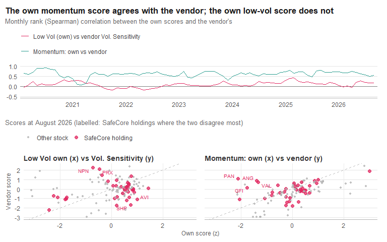<!-- -->

**Interpretation:** These momentum score agree well with the vendor’s:
the monthly rank correlation averages about 0.6. The largest
disagreements among SafeCore’s holdings are the gold and platinum miners
(Pan African, AngloGold, Valterra, Gold Fields), which the vendor still
scores as high-momentum while our 6-month measure does not, which
suggests the vendor uses a longer look-back that still captures their
earlier rally. Our low-volatility score, however, is essentially
unrelated to the vendor’s “Volatility Sensitivity” (average rank
correlation of about 0.1, sometimes negative). Further checks show that
the vendor score is also barely related to realised volatility (-0.18)
or to market beta (-0.08), so it measures something different, most
likely how sensitive a stock is to *changes* in market volatility rather
than how volatile it is. For the question at hand (“is SafeCore a
low-volatility fund?”) our own price-based score is the more direct
measure, and the vendor’s should not be read as a low-vol score.

**Portfolio exposures.** I combine the stock scores into portfolio-level
(composite) scores: the weighted average score of each portfolio’s
holdings, for SafeCore, the Capped SWIX and the four factor indexes. One
finding shaped how I present these: the Capped SWIX scores almost
exactly zero on every vendor factor, which means the vendor’s scores are
benchmark-relative, while ours are standardised across all stocks. To
put both on the same footing, I express every exposure relative to the
Capped SWIX (“active” exposure). This also answers the more useful
question for a manager: how does the fund differ from its benchmark?

``` r
All_Scores  <- Q1B_All_Scores(Own_Scores, Factor_Scores)
Exposures   <- Q1B_Port_Exposures(All_Scores, SC_Holdings, Index_Const)
Active_Exp  <- Q1B_Active_Exposures(Exposures)

Plot_Fingerprint(Active_Exp, Months = 12)
```

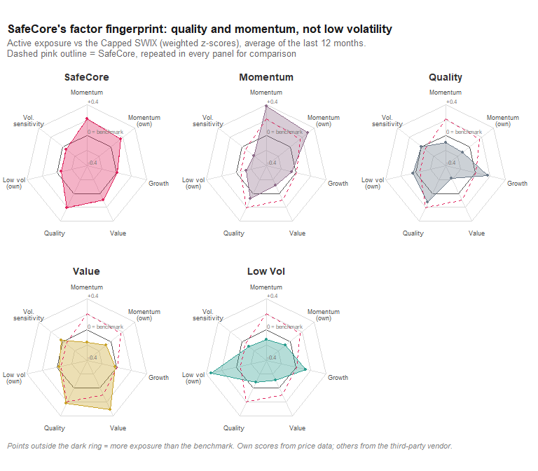<!-- -->

``` r
Plot_Factor_Drift(Active_Exp)
```

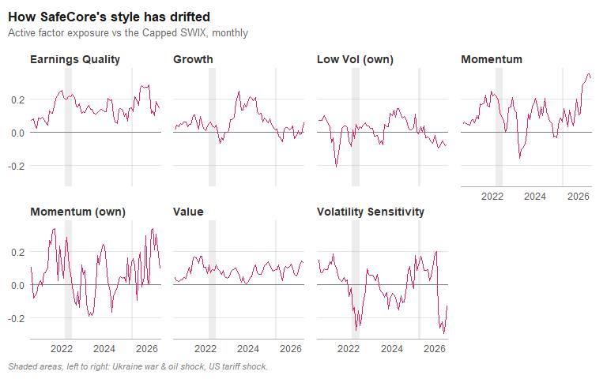<!-- -->

**Interpretation:** The factor indexes behave as expected (the Momentum
index scores highest on momentum, Value on value, Low Vol on low
volatility), which confirms the scores are sensible. Against these
reference points, SafeCore’s fingerprint over the last year is clear: it
is tilted towards **momentum** (+0.21) and **earnings quality** (+0.20),
with a mild **value** tilt (+0.10), and it has no low-volatility tilt
(-0.06 on our score, against +0.33 for the Low Vol index). It looks like
a quality-momentum fund, not a defensive one. The drift chart adds the
timing: SafeCore’s momentum exposure rose sharply in 2026 while its
low-volatility exposure turned negative. This connects the pieces: by
following momentum, the fund has drifted into the gold miners, which is
exactly why resources now dominate its risk.

### Part B conclusion

SafeCore has been a good fund, but it has not been a risk ballast. It
outperformed the Capped SWIX by close to 3% a year since 2015, yet with
the same volatility, a beta close to one, near-full participation in
market falls, and no consistent advantage in stressed periods; it did
worse than the benchmark in the 2022 oil shock. Its volatility is
concentrated: two gold miners carry almost half of its risk, resources
about two thirds, and its effective number of stocks is about half the
benchmark’s. Its style explains why: SafeCore is a quality-momentum fund
whose momentum tilt has recently pulled it into volatile resource
stocks, while it holds fewer rand hedges and rand-neutral stocks than
its benchmark. If the team wants SafeCore to provide some protection in
the global risk-off episodes initially identified, practical options are
to cap the risk contribution of single stocks and sectors (not only
their weights), to monitor the momentum tilt for crowding into one
theme, and to add an explicit low-volatility tilt or sleeve, accepting,
as the rebuilt Low Vol index shows, that this costs some upside in
strong markets.

## Part C: Alpha opportunity in the local market since 2020

**Approach.** Active managers often add value when stocks behave
differently from one another, so I measure the alpha opportunity from
two complementary angles: dispersion (how far apart stock returns are on
a given day) and correlation (how much stocks move together over time).
High dispersion with low correlation is a stock-picker’s market; low
dispersion with high correlation is a macro-driven one where stock
selection matters little. I combine the two into a single Alpha
Opportunity Index, check that it lines up with the returns a ‘good’
stock picker could actually have earned, and then relate it to the
global macro measures from Part A. Constituent data starts in August
2020.

### Dispersion (cross-sectional volatility)

Each day I compute the cross-sectional volatility (CSV) of the Capped
SWIX constituents, both weighted and unweighted:

``` math
CSV^{W}_t = \sqrt{\sum_i w_{i,t-1} (R_{i,t} - \bar{R}_t)^2}, \qquad \bar{R}_t = \sum_i w_{i,t-1} R_{i,t}
```

The weights are the previous day’s index weights (so there is no
look-ahead) and $`\bar{R}_t`$ is then the index return itself. The
weighted version is used as the main measure for two reasons. First, it
measures the opportunity that matters to a manager benchmarked against
the Capped SWIX: a large move in a stock with a tiny index weight
changes little for such a fund. Second, the unweighted measure is
dominated by small, illiquid stocks with erratic prices, which inflate
dispersion without creating opportunity that can actually be
captured.The unweighted version as included as a robustness check.

**Data cleaning.** Two daily “returns” above 100% are corporate-action
artefacts rather than price moves: Richemont’s shareholder warrants
(CFRO) show +369,900% when they listed in November 2020, and Fortress B
shows +106% around its A/B share restructure in February 2024. Even with
a tiny index weight, the warrant print alone lifted November 2020’s
weighted dispersion to about 6%, and the unweighted average for 2020 to
several hundred percent. These two rows are dropped. It is also a good
example of how fragile unweighted dispersion is.

``` r
Const_J433  <- Q1C_Constituents(Index_Const, IndexName = "Capped SWIX")
Daily_CSV   <- Q1C_Daily_CSV(Const_J433)
Monthly_CSV <- Q1C_Monthly_CSV(Daily_CSV)        # daily CSV is noisy, so I average per month

Plot_CSV(Monthly_CSV)
```

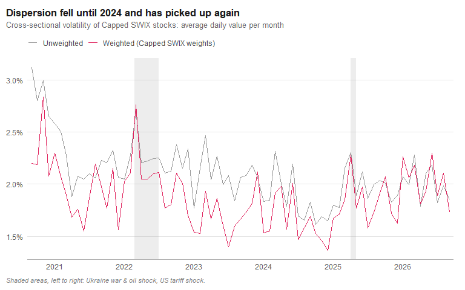<!-- -->

**Interpretation:** Dispersion was high in late 2020 (an average daily
CSV of about 2.3%, as markets recovered unevenly from COVID), fell
steadily to a low of about 1.6% in 2024, and has risen again to about
2.0% in 2026. The unweighted measure is consistently higher (small caps
are noisier), and the two are correlated at 0.74, so the choice of
measure does not change the overall pattern.

Because the weighted variance is a weighted sum of squared deviations,
it can be split exactly into a part within super-sectors (stocks moving
differently from their own sector: the stock-picking opportunity) and a
part between super-sectors (sectors moving differently from each other:
the sector-allocation opportunity).

``` r
Plot_CSV_Decomp(Monthly_CSV)
```

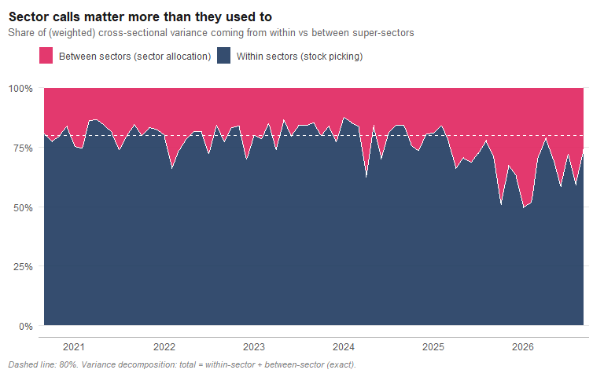<!-- -->

**Interpretation:** Until 2024 about 80% of dispersion came from within
sectors, so the alpha opportunity was mostly about picking stocks. Since
2025 the between-sector share has risen sharply (the within share
averages 71% in 2025 and 65% in 2026, falling to around 50% in some
months). This is the resources story from Part B seen from the market’s
side: resources (gold miners in particular) have moved very differently
from financials and industrials, so getting the sector call right has
become as important as picking stocks within sectors.

### Rolling inter-constituent correlation

At each month-end I compute the correlation matrix of the Large Cap
stocks over the previous 63 trading days, and keep all pairwise
correlations. Rather than collapsing them into one average, I show their
distribution (the median pair and the middle 50% of pairs), because this
shows whether *all* stocks were moving together or only some. I use the
Large Caps (about 40 stocks) because they have reliable daily prices and
are where most institutional money sits.

``` r
Pair_Cor <- Q1C_Roll_PairCor(Index_Const, IndexName = "Large Caps", Window = 63)
Plot_PairCor(Pair_Cor)
```

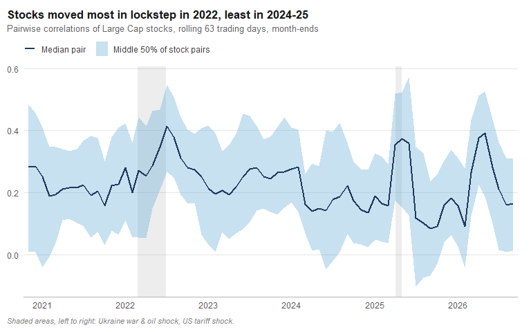<!-- -->

**Interpretation:** The median pairwise correlation peaked in 2022
(around 0.30, the year of the Ukraine war and aggressive rate hikes),
when even the middle 50% band moved up: almost all stocks were being
driven by the same macro forces. Correlations then fell to their lowest
levels in 2024-2025 (around 0.18-0.19) before picking up again in 2026.
Low correlations in 2024-2025 mean stocks were trading more on their own
fundamentals.

### Alpha opportunity: combining dispersion and correlation

Dispersion and correlation are only weakly related in this sample
(correlation of 0.17), so they capture different aspects of the
opportunity and are worth combining. Plotting them against each other
gives a map of market regimes, and the Alpha Opportunity Index
summarises it in one number:
$`z(\text{dispersion}) - z(\text{correlation})`$, where $`z`$
standardises each over the sample. A value of 0 is an average month, and
the units are standard deviations.

``` r
Opportunity <- Q1C_Opportunity(Monthly_CSV, Pair_Cor)

Plot_Opp_Quadrant(Opportunity)
```

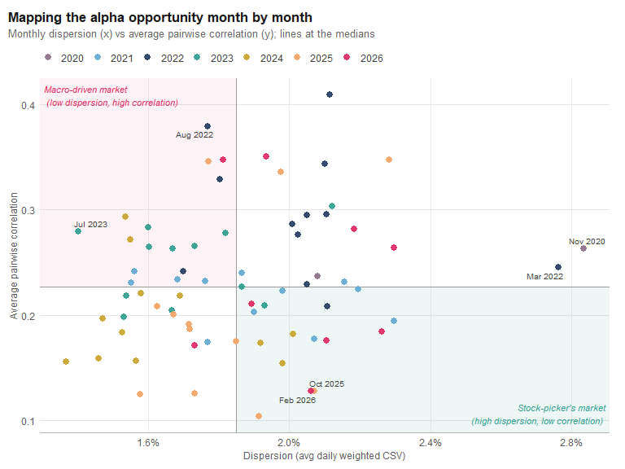<!-- -->

``` r
Plot_Opp_Index(Opportunity)
```

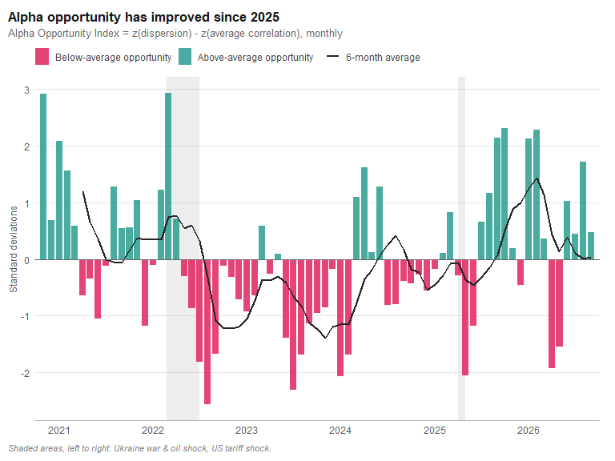<!-- -->

**Interpretation:** The map shows clear clusters by year. 2022 sits in
the high-correlation half (macro-driven), 2023-2024 in the
low-dispersion half, and many 2025-2026 months in the bottom-right
“stock-picker’s” quadrant. The best months for stock pickers were March
2022, November 2020, September-October 2025 and February 2026; the worst
were August 2022, July 2023 and January 2024, when stocks moved together
and little apart. Overall, the alpha opportunity was weak from mid-2022
to 2024 and has improved markedly since 2025.

### Was the opportunity actually realised?

An index like this is only useful if it lines up with returns that a
manager could have earned. I use two “payoff” measures from the data:
the monthly return of the best 20% of Capped SWIX stocks minus the worst
20% (the reward for picking the right stocks), and the gap between the
best and worst of the Value, Momentum, Quality and Low Vol indexes (the
reward for picking the right style).

``` r
Realised <- Q1C_Realised_Spreads(Index_Const)
Plot_Realised(Opportunity, Realised)
```

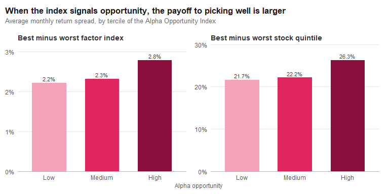<!-- -->

**Interpretation:** In months where the index signalled high
opportunity, the gap between the best and worst stock quintiles averaged
26% a month, compared to 22% in low-opportunity months (correlation
between the index and the spread: 0.51). The gap between factor indexes
is much smaller and only weakly related to the index (2.8% vs 2.2%). So
the index captures a real stock-selection opportunity: when it is high,
the payoff to picking the right stocks is larger. It says less about
style timing.

### Alpha opportunity and global macro factors

I relate monthly dispersion, correlation and the Alpha Opportunity Index
to the global macro measures used in Part A. Two views: the correlation
in the same month and in the next month (does macro stress lead the
opportunity?), and the average dispersion and correlation when each
macro measure is in its lowest vs highest third of months.

``` r
Macro_Vars  <- c("VIX", "VXEEM", "Oil Vol", "MOVE (US bond vol)", "EPU Global", "JPM Global FX vol", "SAVI USDZAR vol")
Macro_Panel <- Q1C_Macro_Panel(Unc_Levels, Opportunity, Monthly_CSV, Pair_Cor, Vars = Macro_Vars)

Plot_LeadLag(Q1C_LeadLag(Macro_Panel, Macro_Vars))
```

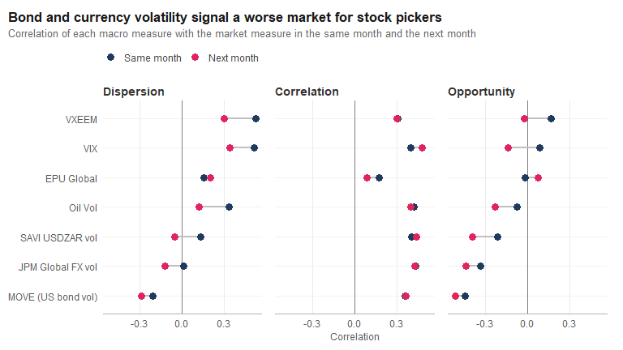<!-- -->

``` r
Plot_Macro_Regimes(Q1C_Macro_Regimes(Macro_Panel, Macro_Vars))
```

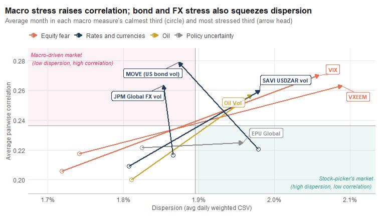<!-- -->

**Interpretation:** Three findings stand out.

1.  **Equity fear raises dispersion and correlation, so its net effect
    is small.** In months with high VIX, dispersion is about 20% higher
    (2.1% vs 1.7%) but the average correlation is also higher (0.27 vs
    0.21), and the VIX predicts even higher correlation the following
    month. Stock prices spread out, but they are also increasingly
    driven by the same risk-on/risk-off swings, so the opportunity index
    barely moves with the VIX.
2.  **Bond and currency volatility are what hurt stock pickers.** High
    US bond volatility (MOVE) goes with lower dispersion and higher
    correlation, and it has the most negative relationship with the
    opportunity index (-0.44 in the same month, -0.51 the next). Global
    FX volatility and rand volatility show the same pattern. When
    interest rates and currencies are moving sharply, they drive all
    stocks together, which is exactly what happened in 2022.
3.  **These macro measures lead the opportunity.** The correlations with
    next month’s opportunity are stronger than with this month’s for
    MOVE, FX volatility, rand volatility and oil volatility. Rising
    rates and currency volatility are therefore an early warning that
    the market is about to become less rewarding for stock selection.
    Policy uncertainty (EPU) again shows almost no relationship,
    consistent with Part A.

### Part C conclusion

The alpha opportunity on the local market was strong in late 2020, weak
from mid-2022 through 2024 when correlations were high and dispersion
low, and has improved markedly since 2025, with several months in the
“stock-picker’s market” quadrant. The opportunity is real, in the sense
that the payoff to picking the right stocks has been larger when the
index is high. Two caveats matter for how it can be used. First, a
growing share of recent dispersion comes from sectors moving apart
(mainly resources), so sector allocation has become as important as
stock picking. Second, the macro environment matters through rates and
currencies rather than through equity fear: rising bond and FX
volatility have tended to precede a more correlated, less rewarding
market.

**Limitations.** With about six years of monthly data (71 observations),
the macro relationships are correlations, not causal effects, and they
are sensitive to a few episodes (2022 in particular). The quintile
spread is a foresight measure: it shows how much there was to gain, not
what any manager actually earned.

# Question 1: Overall conclusion

Taken together, the three parts give a consistent picture. Local
volatility has not risen to a permanently higher level, but volatility
episodes have become more frequent and are largely imported, through
global risk-off shocks and oil price volatility (Part A). SafeCore has
added return but has not protected investors in those episodes: its risk
is concentrated in a few resource stocks, and its quality-momentum style
has no low-volatility tilt (Part B). Meanwhile, the opportunity to add
value through stock selection has improved since 2025, but more of it
now comes from sector moves, and rising bond and currency volatility
have tended to signal tougher conditions for stock pickers (Part C). The
implication for the team is that SafeCore can keep its stock-selection
edge while building in a risk ballast that targets the shocks that
actually drive local volatility: limiting single-stock and sector risk,
adding a low-volatility tilt, and monitoring global rates and currency
volatility as early warnings.

# Question 2: Mid, Small and Large Cap Indices

All functions for this question may be found in
`Questions/Question2/code/` with the write-up in the research report
`Questions/Question2/Question2.Rmd`.

``` r
list.files("Questions/Question2/code/", full.names = TRUE) %>%
    .[grepl("[.]R$", .)] %>%
    walk(~source(.))
```

**Approach.** An investor choosing between the large, mid and small cap
indexes is really choosing between different bets on the economy,
necessitating a comparison on three levels. First their structure: what
sectors they hold, how concentrated they are, and how different they are
from the broad market (active share against the Capped SWIX). Then their
risk: how volatile the individual stocks are compared with the index as
a whole, and how the indexes behave in a GARCH model. Finally their
returns: rolling returns over time, a risk-return summary, and a
stratification of months by rand and global stress to see which index
holds up when it matters.

### Data

The size index holdings are monthly from 2007, so the structure analysis
covers 2007-2026. Daily index returns (J200 for large caps, J201 mid
caps, J202 small caps and J433 for the Capped SWIX) start in 2015, so
the risk and return analysis covers 2015-2026.

``` r
Size_Idx    <- read_rds("data/Monthly_Index_Constituents.rds")
Q2_Holdings <- Q2_Size_Holdings(Size_Idx, Index_Const)
Q2_Rets     <- Q2_Index_Returns(Idx_Daily)
```

Data checks:

- Weights sum to 84-100% in some months, which are rescaled to 100% per
  index and month.
- About 16% of rows have no sector. These are filled from the same
  stock’s sector in other months and then from the daily constituent
  file used in Question 1. What remains is labelled “Unclassified”
  rather than dropped: this is almost entirely older small caps (before
  2020), and only about 8% of small-cap weight after 2015.
- Daily stock returns above 100% (the corporate-action artefacts found
  in Question 1) are excluded from the constituent volatility
  calculations.

### 1. Structure: sector exposure, concentration and active share

``` r
Plot_Q2_Sectors(Q2_Sector_Mix(Q2_Holdings))
```

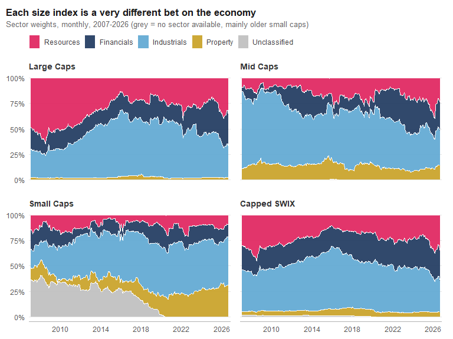<!-- -->

**Interpretation:** The three indexes are very different bets on the
economy. Large caps were dominated by resources in 2007 (about half the
index), then shifted towards industrials until about 2016, and resources
are back near 40% today. Mid caps started out as an industrials index
(over 75% in 2007) and have become much more balanced, with financials
now close to 30%. Small caps are mostly industrials and, increasingly,
property (31% today). So an investor moving down the size spectrum is
not only buying smaller companies, but swapping commodity exposure for
locally listed industrial, financial and property businesses. As Section
5 shows, though, locally listed does not mean exposed to the rand: much
of the small-cap property weight earns offshore income.

Concentration is shown with Lorenz curves: stocks are sorted from the
smallest to the largest weight, and the curve plots the cumulative share
of stocks against the cumulative share of index weight. An equally
weighted index lies on the diagonal, and the further the curve bows
below it, the more a few large stocks dominate. The Gini coefficient
summarises this in one number (0 = equal weights). The difference from
the broad market is measured by active share against the Capped SWIX:

``` math
\text{Active share}_t = \frac{1}{2}\sum_i \left| w_{i,t}^{\text{index}} - w_{i,t}^{\text{SWIX}} \right|
```

which is 0% for identical holdings and 100% when the two share no stocks
at all. Active share only compares holdings, so it is paired with
tracking error (the annualised volatility of the return difference
against the Capped SWIX). Following Cremers and Petajisto (2009), the
two together classify a portfolio as a closet indexer (low active share,
low tracking error), a diversified stock picker (high active share, low
tracking error), a factor bet (low active share, high tracking error) or
a concentrated stock picker (high on both), using cut-offs of 60% active
share and 8% tracking error.

``` r
Q2_ASTE <- Q2_AS_TE(Q2_Holdings, Q2_Rets)       # active share and tracking error per year
Plot_Q2_Lorenz_ASTE(Q2_Lorenz(Q2_Holdings), Q2_ASTE)
```

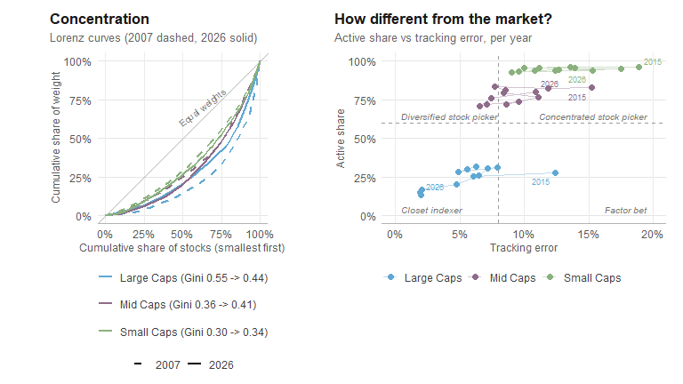<!-- -->

**Interpretation:** The Lorenz curves show that large caps were by far
the most concentrated index in 2007 (Gini 0.55) but have become much
less so (0.44 in 2026), while mid and small caps have moved the other
way (from 0.36 to 0.41 and from 0.30 to 0.34). The biggest change came
in June 2023, when Richemont (about 22% of the index) drops out of the
large cap holdings in the data. The active share map shows what this
means for an investor. Large caps have moved into the closet-indexer
corner: by 2026 their active share against the Capped SWIX is 13% and
their tracking error only 2%, so the large cap index is now close to a
replica of the broad market. Small caps sit firmly in the
concentrated-stock-picker zone (active share of about 95% and tracking
error of 9-19% a year), while mid caps move between the diversified and
concentrated zones, as their tracking error rises in turbulent years
(2015, 2020, 2026) and falls in calm ones.

### 2. Risk: constituent volatility, diversification and GARCH

The question asks for a comparison of the realised volatility of the
constituents over time. Each month, the 6-month (126-day) realised
volatility of every stock in each index is computed, and the figure
shows the median stock and the middle 50% of stocks.

``` r
Q2_Const_Vol <- Q2_Constituent_Vol(Q2_Holdings, Stock_Rets)
Plot_Q2_Const_Vol(Q2_Const_Vol)
```

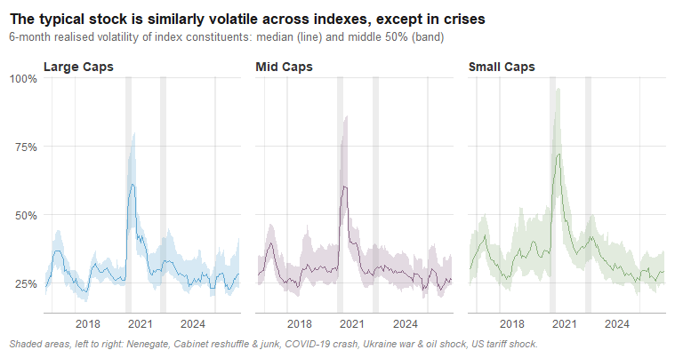<!-- -->

**Interpretation:** Outside crises, the typical stock is about equally
volatile in all three indexes (a median of about 25-35% a year). The
differences appear in stress: during COVID the median small-cap stock
reached about 70% volatility against about 60% for large and mid caps,
and the spread between the most and least volatile small caps was much
wider.

This raises a puzzle: small-cap stocks are individually at least as
volatile as large- and mid-cap stocks (and more so in crises), yet the
small cap index is the least volatile of the three. To explain it, each
index’s volatility is compared with the weighted average volatility of
its stocks. The ratio is low when stocks move independently of one
another, so that their swings cancel out in the index.

``` r
Plot_Q2_Div_Scatter(Q2_Diversification(Q2_Const_Vol, Q2_Rets))
```

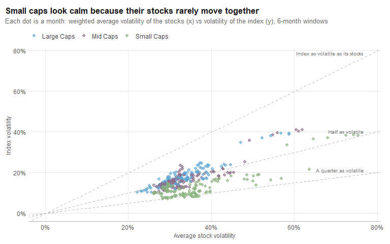<!-- -->

**Interpretation:** Each dot is a month. The large and mid cap dots
cluster around the half-as-volatile ray, while most small cap dots sit
close to the quarter-as-volatile ray (a long-run average ratio of about
0.35, against about 0.5 for the others). Small-cap stocks rarely move
together, partly because they are driven by company-specific news and
partly because many trade infrequently, so stale prices damp the
measured index volatility. The low index volatility of small caps is
therefore not the same as low risk: in crisis months (the dots far to
the right, mainly 2020) the small cap dots move up towards the
half-as-volatile ray, as their stocks suddenly move together, which is
exactly when diversification is needed.

Finally, the same GJR-GARCH(1,1) model as in Question 1 (AR(1) mean,
skewed-t errors) is fitted to the three index return series. These
fitted models are used to draw news impact curves: how much next-day
volatility rises after a daily shock of a given size and sign. This
shows directly whether an index’s volatility is triggered mainly by
falls or by moves in either direction.

``` r
Q2_Garch <- Garch_Fit_Sigma(Q2_Rets, Names = c("Large Caps", "Mid Caps", "Small Caps"), Model = "gjrGARCH")
Q2_Garch$Params %>% knitr::kable(digits = 4)
```

| Name       | alpha1 |  beta1 | gamma1 | Persistence | HalfLife_days |
|:-----------|-------:|-------:|-------:|------------:|--------------:|
| Large Caps | 0.0056 | 0.8863 | 0.1409 |      0.9602 |       17.0515 |
| Mid Caps   | 0.0266 | 0.8871 | 0.0859 |      0.9554 |       15.1800 |
| Small Caps | 0.0696 | 0.8473 | 0.0702 |      0.9517 |       13.9951 |

``` r
Plot_Q2_News_Impact(Q2_News_Impact(Q2_Garch$Fits))
```

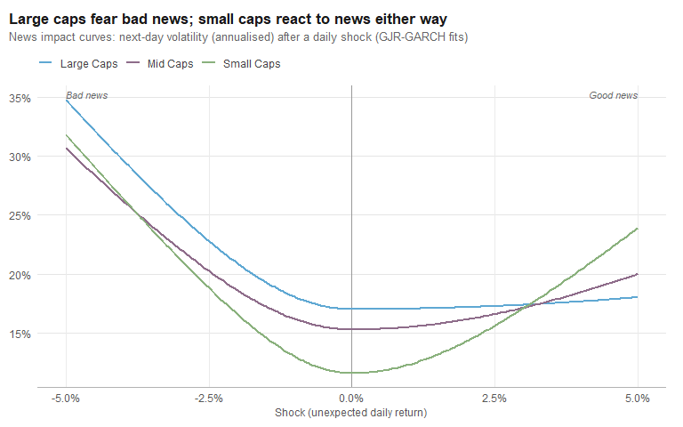<!-- -->

**Interpretation:** The curves show that the indexes face different
kinds of volatility. After a 3% fall, large-cap volatility jumps from
about 17% to 25% a year, but after a 3% rise it barely moves (17.4%).
Small caps start from a much lower base (about 11.5%, consistent with
the diversification result) and react strongly in both directions: to
about 21% after a 3% fall and 17% after a 3% rise. The parameters
confirm this. Large-cap volatility is driven almost entirely by bad news
(leverage term $`\gamma`$ of 0.14 and a symmetric term $`\alpha`$ near
zero), the same pattern as the broad market in Question 1: large caps
react to global sell-offs. Small caps have a much larger $`\alpha`$
(0.07) and a smaller $`\gamma`$ (0.07), so their volatility responds to
news of either sign, which fits a segment driven by company-specific and
domestic news. Shocks are short-lived in all three (half-lives of 14-17
trading days).

### 3. Returns: rolling returns and risk-return profiles

Rolling returns show how the ranking of the indexes changes over time,
which a single full-period number hides. 1-year and 3-year annualised
rolling returns are computed from monthly returns and shown relative to
the Capped SWIX as a heat strip, where each tile is one month.

``` r
Q2_Roll <- Q2_Rolling_Returns(Q2_Rets, Years = c(1, 3))
Plot_Q2_Roll_Heat(Q2_Roll)
```

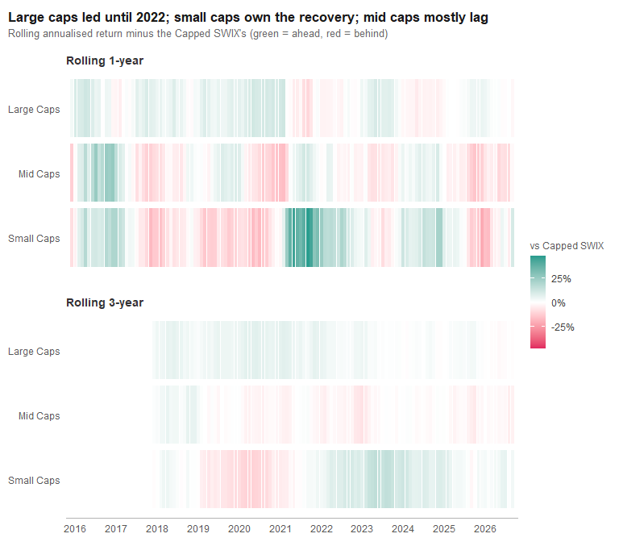<!-- -->

**Interpretation:** Large caps beat the Capped SWIX over most 3-year
windows (88% of them), with the lead built mainly before 2022 (the green
band in the large cap row of the 3-year panel). Small caps are the most
cyclical: they fell furthest into the COVID crash (a 3-year return of
about -18%), then led the market by up to 16% a year in the recovery of
2021-2023 (the darkest green tiles). Mid caps lagged the Capped SWIX in
most windows (they beat it in only about a third of them).

``` r
Q2_RR <- Q2_Risk_Return(Q2_Rets, STeFI)
Q2_RR %>% knitr::kable(digits = 3)
```

| Name        | AnnRet | AnnVol |  MaxDD | Sharpe |
|:------------|-------:|-------:|-------:|-------:|
| Capped SWIX |  0.087 |  0.178 | -0.417 |  0.102 |
| Large Caps  |  0.110 |  0.187 | -0.346 |  0.225 |
| Mid Caps    |  0.073 |  0.174 | -0.423 |  0.030 |
| Small Caps  |  0.103 |  0.140 | -0.513 |  0.252 |

``` r
Plot_Q2_Risk_Return(Q2_RR)
```

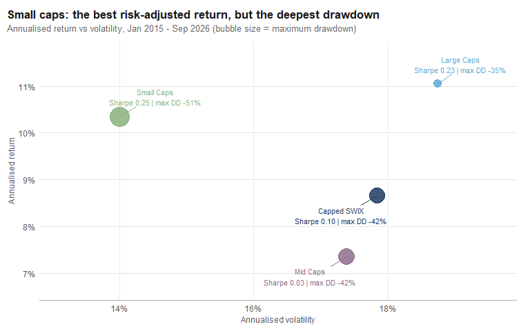<!-- -->

**Interpretation:** Over 2015-2026 large caps returned about 11.0% a
year and small caps 10.3%, both ahead of the Capped SWIX (8.7%), while
mid caps returned only 7.3%. Small caps did this with the lowest
volatility (14%) and so have the best Sharpe ratio (0.25, using STeFI as
cash), but they also suffered by far the deepest drawdown (-51%, during
COVID). That combination is the clearest sign that their low measured
volatility understates their true risk. Mid caps offered the worst
risk-return trade-off, with a Sharpe ratio close to zero.

### 4. Stratification: which index holds up under stress?

The stratification approach is as follows: identify the months in the
top 20% (most stressed) and bottom 20% (calmest) of a stress measure,
and compare each index’s behaviour in those months with its full-sample
behaviour. Daily returns are winsorised at the 1st and 99th percentiles
first, so that a few extreme days do not drive the comparison. Two
stratifiers are used: rand volatility (SAVI) for local currency stress
and the VIX for global risk aversion.

``` r
SAVI_Q2 <- Q2_SAVI(Local_Cncy_Vol_Index) %>% filter(date >= as.Date("2015-01-01"))
VIX_Q2  <- Implied_Vol %>% filter(Name == "VIX", date >= as.Date("2015-01-01")) %>% select(date, Value = TRI)

Strat_Months <- bind_rows(Q2_Strat_Months(SAVI_Q2, "Rand volatility (SAVI)"),
                          Q2_Strat_Months(VIX_Q2, "Global fear (VIX)"))
Q2_Strat <- Q2_Stratify(Q2_Rets, Strat_Months)      # volatility (vs full sample) and average return per regime
Q2_Strat %>% select(Stratifier, Regime, Name, VolRatio, AvgMonthlyRet) %>% knitr::kable(digits = 3)
```

| Stratifier             | Regime | Name        | VolRatio | AvgMonthlyRet |
|:-----------------------|:-------|:------------|---------:|--------------:|
| Global fear (VIX)      | High   | Capped SWIX |    1.332 |         0.013 |
| Global fear (VIX)      | High   | Large Caps  |    1.318 |         0.018 |
| Global fear (VIX)      | High   | Mid Caps    |    1.304 |         0.014 |
| Global fear (VIX)      | High   | Small Caps  |    1.388 |         0.017 |
| Global fear (VIX)      | Low    | Capped SWIX |    0.772 |         0.008 |
| Global fear (VIX)      | Low    | Large Caps  |    0.774 |         0.010 |
| Global fear (VIX)      | Low    | Mid Caps    |    0.839 |         0.007 |
| Global fear (VIX)      | Low    | Small Caps  |    0.745 |         0.009 |
| Rand volatility (SAVI) | High   | Capped SWIX |    1.214 |        -0.001 |
| Rand volatility (SAVI) | High   | Large Caps  |    1.181 |         0.003 |
| Rand volatility (SAVI) | High   | Mid Caps    |    1.195 |         0.010 |
| Rand volatility (SAVI) | High   | Small Caps  |    1.156 |         0.000 |
| Rand volatility (SAVI) | Low    | Capped SWIX |    0.911 |         0.022 |
| Rand volatility (SAVI) | Low    | Large Caps  |    0.912 |         0.022 |
| Rand volatility (SAVI) | Low    | Mid Caps    |    0.902 |         0.019 |
| Rand volatility (SAVI) | Low    | Small Caps  |    0.823 |         0.015 |

``` r
Plot_Q2_Strat_Box(Q2_Strat_Monthly(Q2_Rets, Strat_Months))
```

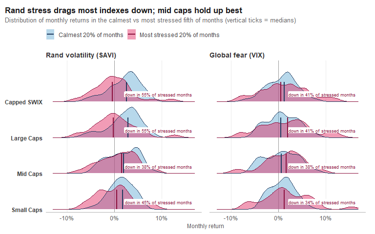<!-- -->

**Interpretation:** The box plots show the whole spread of monthly
outcomes, not only the averages. Rand stress is clearly bad for local
equities: in the calmest fifth of months for the rand, the median
monthly return was about 1.7-2.9% for every index, but in the most
stressed fifth the Capped SWIX fell in 55% of months (median -0.5%), and
large and small caps did little better. Mid caps held up best, falling
in only 38% of rand-stress months with a median return of +1.5%. The
table shows that volatility rises by a similar 15-20% in all indexes in
rand-stress months, while global stress (VIX) raises it by 30-40%, most
for small caps relative to their normal level. Average returns are
actually higher in high-VIX months, but the much wider boxes show why:
these months contain both the worst falls and the sharp rebounds that
follow sell-offs (e.g. April-May 2020), so this is volatility, not
protection.

### 5. Beyond size: the hidden style and currency bets

The analysis so far compares the indexes by size, but it raises a
question the data can answer directly: *what is an investor really
buying when they choose a size index?* Answering it draws on two
datasets. The third-party factor scores give each index’s style, using
the same benchmark-relative approach as for SafeCore in Question 1 (the
weighted average score of its holdings relative to the Capped SWIX, over
the last 12 months), and the rand-hedge classification, also used for
SafeCore, gives its currency profile. A final check is whether the SA
size effect simply mirrors the global one, using the MSCI World small
and mid cap index.

``` r
Q2_FE <- Q2_Factor_Exposures(Q2_Holdings, Factor_Scores, Months = 12)
Q2_HP <- Q2_Hedge_Profile(Q2_Holdings, Hedge_Plays)
Plot_Q2_Hidden_Bets(Q2_FE, Q2_HP)
```

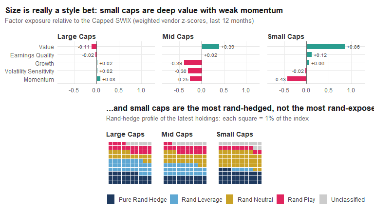<!-- -->

``` r
# Is the SA size effect a global one? (annual premium and correlation with the global spread)
Q2_Global_Size(Idx_Daily, MSCI) %>% knitr::kable(digits = 3)
```

| Spread                         | AnnPremium | CorWithGlobal |
|:-------------------------------|-----------:|--------------:|
| SA small minus large           |     -0.006 |         0.093 |
| SA mid minus large             |     -0.032 |         0.168 |
| Global small & mid minus world |     -0.020 |         1.000 |

**Interpretation:** Size turns out to be a proxy for style. Large caps
sit close to the benchmark on every factor. Mid caps are tilted towards
value (+0.39), with weak growth (-0.39) and negative momentum (-0.25),
and small caps are a deep-value bet (+0.86) on stocks with poor recent
momentum (-0.43). This helps explain the return results: the mid and
small cap indexes are concentrated in cheap, out-of-favour stocks, which
lagged over a decade led by the large caps, and the strong small-cap
recovery of 2021-2023 coincided with the rebound in value stocks after
COVID.

The currency profile overturns a common assumption. Small caps are not
the “SA Inc.” rand play they are often taken to be: they hold the most
pure rand hedges (33%, against 27% for large caps) and the fewest rand
plays (10%). The largest small-cap rand hedges are property stocks
(Vukile, Fortress B, Resilient), consistent with the offshore property
portfolios several SA REITs hold, alongside global businesses such as
Datatec and Bytes Technology. Mid caps have a currency mix close to the
broad market, so their resilience in months of rand stress (Section 4)
is not explained by currency hedges, and more likely reflects their
sector and style mix.

Finally, the SA size effect is local rather than global. Since 2015
small caps returned about 0.6% a year less than large caps and mid caps
about 3.2% less, while globally small and mid caps lagged the world
index by about 2% a year. But the monthly SA spreads are barely
correlated with the global one (0.09 for small caps, 0.17 for mid caps).
Unlike volatility in Question 1, which was largely imported, the
relative performance of the SA size segments is driven by local factors.

### Question 2 conclusion

The size indexes offer very different risk and return profiles. Large
caps have delivered the strongest returns since 2015 and, since
Richemont left the index in 2023, are now close to a copy of the broad
market; their volatility is driven by global sell-offs. Small caps look
the safest on paper, with the lowest volatility and best Sharpe ratio,
but this reflects stocks that rarely move together and trade
infrequently: when a crisis hits, their stocks move together and they
suffered the deepest drawdown. Mid caps have been the weakest segment
over the decade, but held up best in months of rand stress. For an
investor, the choice between them is less about company size than about
exposure: large caps for global and resource exposure, mid caps for a
value-tilted exposure to local businesses, and small caps for a
deep-value bet that is, perhaps surprisingly, the most rand-hedged
segment of the market. The caveat is that small caps’ smooth returns
hide significant crash risk.

# Question 3: Portfolio Return Comparison (ABC Fund)

All functions for this question are in `Questions/Question3/code/`. The
output is a PowerPoint deck, `Questions/Question3/Question3.Rmd`.

``` r
list.files("Questions/Question3/code/", full.names = TRUE) %>%
    .[grepl("[.]R$", .)] %>%
    walk(~source(.))
```

**Approach.** Active managers are increasingly asked to justify their
fees by showing what they offer beyond the market, so a strong case for
any fund rests on how it compares with its peers. Four questions frame
that comparison here. First, how much of the industry is simply market
beta, and does ABC offer something else? Second, how different are the
drivers of ABC’s returns from those of the industry? Third, how has ABC
performed relative to peers over time? And, finally, does ABC really do
well when market dispersion is high? Each claim is tested against the
data.

### Data

``` r
Active_Managers <- read_rds("data/Active_Managers.rds")
ABC_Fund        <- read_rds("data/ABC_Fund.rds")

Q3_Funds_M <- Q3_Funds(Active_Managers, ABC_Fund)     # peers (winsorised) + ABC, monthly
Q3_Bench_M <- Q3_Bench(Idx_Daily)                     # Capped SWIX, monthly
Q3_Cash_M  <- Q3_Cash(STeFI)                          # STeFI, monthly
```

Data checks:

- The peer file holds monthly returns for 247 funds from November 2005
  to October 2025, with between 59 and 154 funds reporting in any month,
  as funds launch and close. ABC Fund’s returns run from July 2012 to
  October 2025.
- The Capped SWIX benchmark is only available from January 2015, so
  every benchmark-based measure (beta, R-squared, excess returns) covers
  2015-2025. Peer rankings use ABC’s full history.
- Fund Z182 reports -55% in April 2025, its final month in the data,
  which looks like a fund wind-down rather than an investment return.
  Peer returns are therefore winsorised each month at the 1st and 99th
  percentiles.
- Funds that closed during the period are kept for as long as they
  reported, so the peer group is not limited to survivors.

### 1. How much of the industry is market beta?

Rolling 36-month betas against the Capped SWIX are computed for every
fund, together with the R-squared of the same regression (the share of
the fund’s monthly return variation explained by the market). Only
complete 36-month windows are used. The manager suggested overlaying box
plots on a scatter, which is what the first chart does at each year-end.

``` r
Q3_Roll_Beta <- Q3_Rolling_Beta(Q3_Funds_M, Q3_Bench_M, Window = 36)
Plot_Q3_Beta_Box(Q3_Beta_Snapshots(Q3_Roll_Beta))
```

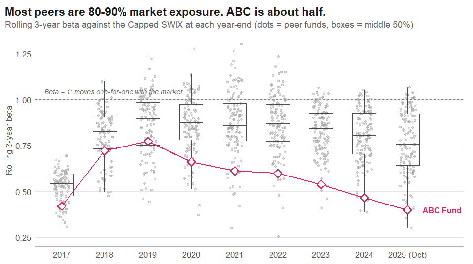<!-- -->

``` r
Plot_Q3_Beta_R2(Q3_Roll_Beta)
```

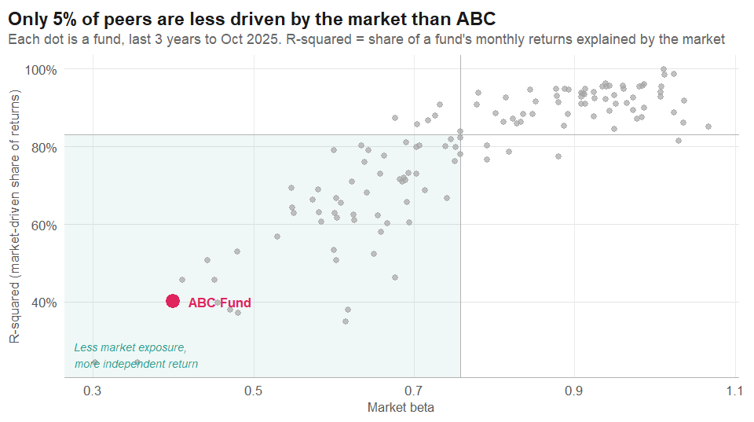<!-- -->

**Interpretation:** Active managers in this industry are mostly market
exposure: since 2018 the median peer’s rolling 3-year beta has been
0.8-0.9, and the middle half of peers sits between roughly 0.7 and 1.0.
ABC’s beta has been well below the peer box in every year and has fallen
to about 0.4. The second chart adds the R-squared: for most peers the
market explains over 80% of monthly returns, while for ABC it explains
about 40%, a lower share than for 95% of peers. ABC therefore does
provide “something other than market beta”: most of its return variation
comes from the manager’s own positions.

### 2. Do ABC’s returns have different drivers?

Rather than assume what drives the industry, the common drivers are
estimated directly with principal component analysis on the last five
years of peer returns, using the 119 peers with a complete record over
that window. ABC is not used to build the components; it is projected
onto them afterwards, like any outside fund.

``` r
Q3_PCA_Out <- Q3_PCA(Q3_Funds_M, Months = 60)
round(Q3_PCA_Out$VarShare[1:3], 3)       # share of peer return variation explained by PC1-PC3
```

    ## [1] 0.824 0.035 0.027

``` r
Plot_Q3_Drivers(Q3_PCA_Out)
```

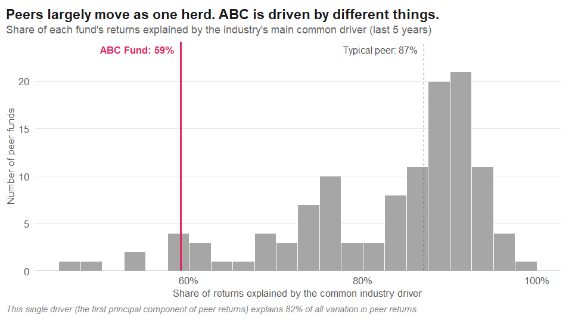<!-- -->

**Interpretation:** A single component explains 82% of all variation in
peer returns, and it is essentially the market (its correlation with the
Capped SWIX is 0.97 in absolute value). The industry therefore largely
moves as one herd. This common driver explains 87% of the typical peer’s
returns but only 59% of ABC’s, and 95% of peers are more tied to it than
ABC. In portfolio terms, ABC is one of the few funds that adds a
genuinely different return stream to a client portfolio, rather than
another version of the same market exposure.

To present the same analysis in the standard form used in Practical 4,
the PCA is repeated with `FactoMineR::PCA`, adding ABC as a
*supplementary* variable: its correlation with each component is
computed, but it plays no part in building them. The scree plot and the
variable correlation circle summarise the result.

``` r
Q3_PCA_F <- Q3_PCA_Prac(Q3_Funds_M, Months = 60)
round(Q3_PCA_F$eig[1:5, ], 2)              # eigenvalues and % of variance
```

    ##        eigenvalue percentage of variance cumulative percentage of variance
    ## comp 1      98.10                  82.44                             82.44
    ## comp 2       4.19                   3.52                             85.96
    ## comp 3       3.16                   2.66                             88.61
    ## comp 4       2.03                   1.70                             90.32
    ## comp 5       1.34                   1.13                             91.44

``` r
Q3_PCA_F$quanti.sup$coord[, 1:2]          # ABC's correlation with components 1 and 2
```

    ##     Dim.1     Dim.2 
    ## 0.7685422 0.2986783

``` r
Plot_Q3_PCA_Prac(Q3_PCA_F)
```

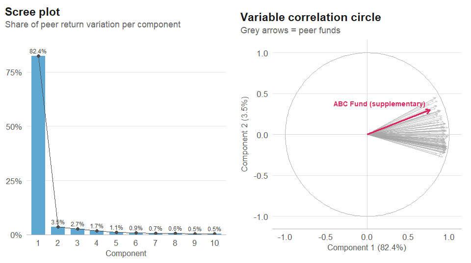<!-- -->

**Interpretation:** The scree plot drops sharply after the first
component (82.4%), with no other component explaining more than 3.5%, so
one factor is enough to describe how the industry moves. In the
correlation circle, almost every peer arrow reaches the edge of the
circle along the first component (a median correlation of 0.93), meaning
those funds are almost fully described by it. ABC’s arrow is shorter (a
correlation of 0.77 with the first component) and points upwards towards
the second component (0.30, against about zero for the typical peer):
less of ABC’s return is explained by the industry’s common driver, and
more by a secondary theme that most peers do not share.

### 3. Relative performance over time

ABC’s rolling 3-year return is ranked against every peer with a full
3-year record at the same date, giving a percentile. A scorecard then
summarises where ABC ranks on six measures over the common benchmark
period, expressed as “better than x% of peers” so that a higher number
is always better.

``` r
Q3_Rank <- Q3_Rolling_Rank(Q3_Funds_M, Window = 36)
Plot_Q3_Rank(Q3_Rank)
```

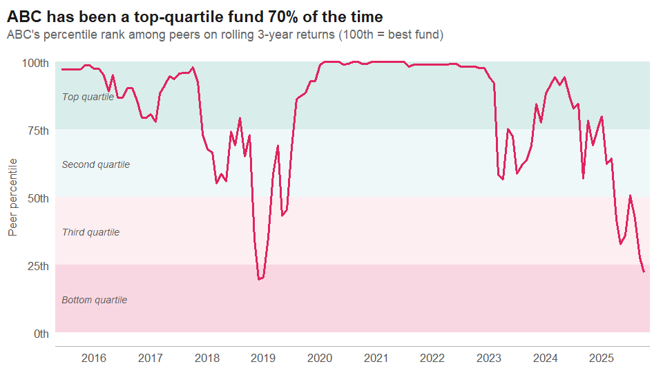<!-- -->

``` r
Q3_Score <- Q3_Scorecard(Q3_Funds_M, Q3_Bench_M, Q3_Cash_M)
Q3_Score %>% filter(Group == "ABC Fund") %>% select(Measure, Value, Pctile) %>% knitr::kable(digits = 3)
```

| Measure           |  Value | Pctile |
|:------------------|-------:|-------:|
| Annual return     |  0.119 | 89.041 |
| Volatility        |  0.111 | 90.411 |
| Sharpe ratio      |  0.482 | 91.781 |
| Information ratio |  0.207 | 87.671 |
| Max drawdown      | -0.137 | 95.205 |
| Market beta       |  0.537 | 96.575 |

``` r
Plot_Q3_Scorecard(Q3_Score)
```

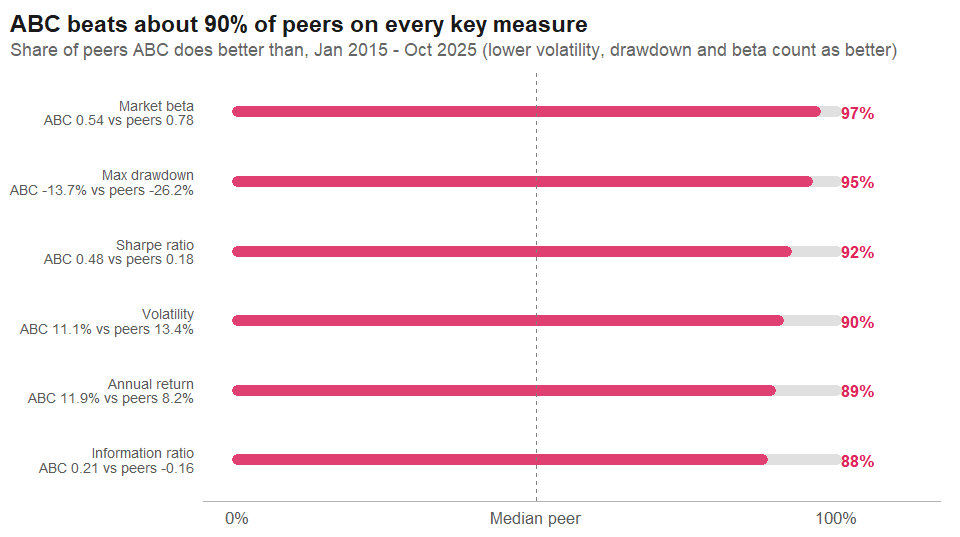<!-- -->

**Interpretation:** ABC has been in the top quartile of its peers in 70%
of rolling 3-year windows since mid-2015, and in the bottom quartile
only 2% of the time, with its strongest run in 2020-2022 (close to the
100th percentile). Over 2015-2025 it returned 11.9% a year against 8.2%
for the median peer, with lower volatility (11.1% vs 13.4%), half the
maximum drawdown (-13.7% vs -26.2%) and a Sharpe ratio of 0.48 against
0.18, putting it ahead of 88-97% of peers on every measure. The 2025 dip
is real and should not be hidden: its 3-year rank fell to about the 22nd
percentile as a strong, broad market rally favoured higher-beta funds.

### 4. Does ABC do well when dispersion is high?

The manager’s claim is tested directly. Market dispersion is measured
each month as the weighted cross-sectional volatility of the Capped SWIX
constituents’ monthly returns (index weights from the previous
month-end, built from the monthly constituent file and daily stock
returns, from 2015). ABC’s monthly excess return, against both the
benchmark and the median peer, is then compared across months of low,
medium and high dispersion, and regressed on dispersion with Newey-West
standard errors, which correct for the autocorrelated residuals.

``` r
Q3_Disp  <- Q3_Market_Dispersion(Size_Idx, Stock_Rets)
Q3_ABC_M <- Q3_ABC_Monthly(Q3_Funds_M, Q3_Bench_M, Q3_Disp)

Q3_Dispersion_Test(Q3_ABC_M) %>% knitr::kable(digits = 4)
```

| Var      | Label              |   Slope |     SE |       t |      p |     R2 |
|:---------|:-------------------|--------:|-------:|--------:|-------:|-------:|
| vs_Bench | vs the Capped SWIX | -0.0018 | 0.0047 | -0.3770 | 0.7068 | 0.0035 |
| vs_Peers | vs the median peer |  0.0000 | 0.0037 |  0.0103 | 0.9918 | 0.0000 |

``` r
Plot_Q3_Dispersion(Q3_ABC_M)
```

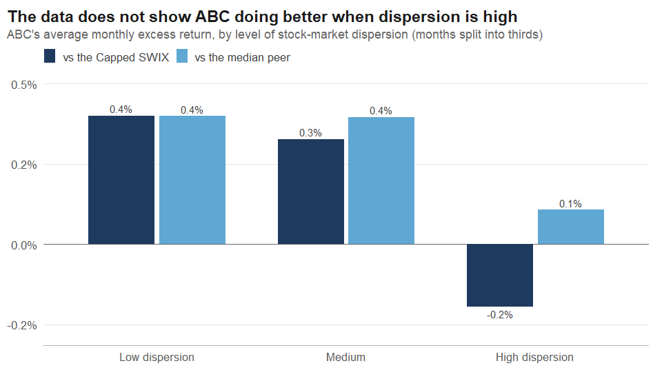<!-- -->

**Interpretation:** The data does not support the claim. ABC’s average
excess return is about +0.4% a month in low-dispersion months and
slightly lower in high-dispersion months (-0.2% against the benchmark,
+0.1% against peers), and the regression slopes are statistically
indistinguishable from zero (p-values of 0.71 and 0.99). As a robustness
check, the dispersion of peer returns (correlated 0.80 with market
dispersion) was also used: ABC then does slightly better in
high-dispersion months, but the relationship is again not statistically
significant (p-values of 0.61 and 0.46). Either way there is no reliable
evidence for the claim, so presenting it to clients would be risky.

The low beta suggests a different and much stronger message, which the
final chart tests: how ABC performs when the market itself falls.

``` r
Plot_Q3_Market_Regimes(Q3_ABC_M)
```

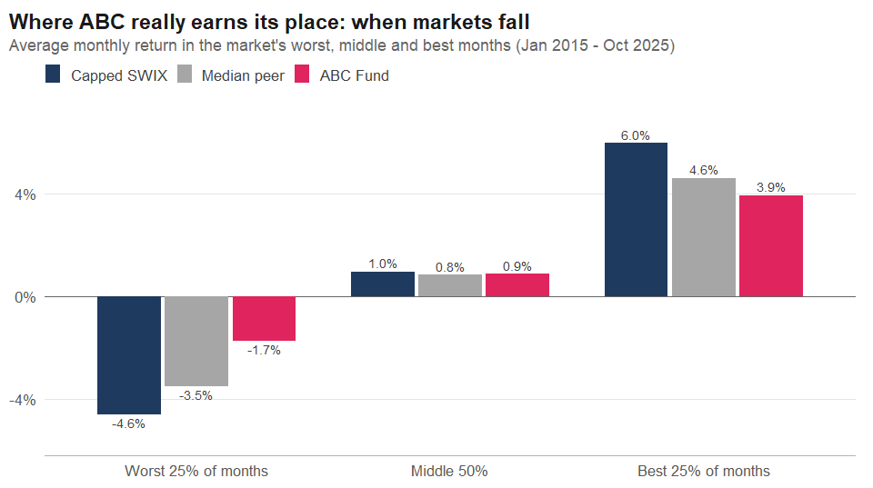<!-- -->

**Interpretation:** In the market’s worst quarter of months, the Capped
SWIX fell 4.6% on average and the median peer 3.5%, but ABC only 1.7%,
ranking around the 74th percentile of peers in those months. ABC
captures only about 39% of the market’s falls, against about 75% for the
typical peer, and only 1% of peers protect better. It gives up some
upside in the strongest months (3.9% against 6.0% for the market), but
losing much less in bad months is what produces its higher long-run
return with lower risk.

### 5. Skill or luck?

A question clients will ask, even though the brief does not: is ABC’s
outperformance skill, or could it be luck? For every fund with at least
five years of data, a CAPM regression of its excess return over cash
(STeFI) on the market’s excess return gives Jensen’s alpha, the return
earned beyond what market exposure explains. Newey-West t-statistics
measure how reliably that alpha was earned: a t-statistic above about 2
means it is unlikely to be luck.

``` r
Q3_Alpha_Out <- Q3_Alpha(Q3_Funds_M, Q3_Bench_M, Q3_Cash_M)
Q3_Alpha_Out %>% filter(Group == "ABC Fund") %>% knitr::kable(digits = 4)
```

| Name     | Group    |  Alpha | t_Alpha | p_Alpha |   Beta | Months |
|:---------|:---------|-------:|--------:|--------:|-------:|-------:|
| ABC Fund | ABC Fund | 0.0363 |  1.7611 |  0.0806 | 0.5392 |    130 |

``` r
Plot_Q3_Alpha(Q3_Alpha_Out)
```

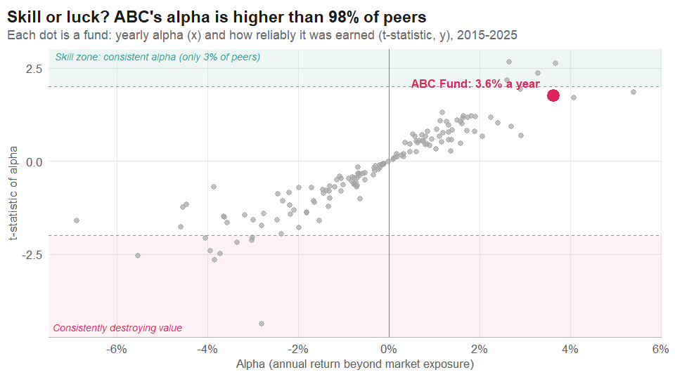<!-- -->

**Interpretation:** ABC’s alpha is about 3.6% a year, higher than 98% of
its peers, while the median peer’s alpha is slightly negative (-0.3%),
which is what one would expect from an industry that mostly holds the
market and charges fees. The t-statistic of 1.76 places ABC just below
the conventional threshold of 2 (significant at the 10% level, p =
0.08), and only 3% of peers clear that threshold at all. The evidence
for skill is therefore strong relative to peers, but should be presented
carefully: ten years of monthly data is still a short sample for proving
skill.

### Question 3 conclusion

The case for ABC rests on three well-supported points: it is a genuine
diversifier i.e half the market beta of its peers, and much less tied to
the factor that drives the rest of the industry; it has been
consistently strong reflected in its position in the top-quartile 70% of
the time and ahead of about 90% of peers on return and risk measures;
and it protects capital when markets fall. The manager’s dispersion
argument is not supported and should be replaced by the
downside-protection message. ABC’s alpha of about 3.6% a year, higher
than 98% of peers and significant at the 10% level, suggests this record
reflects skill rather than luck. The deck also flags the honest caveats:
ABC lags in the strongest rallies, as in 2025, and benchmark-based
comparisons only start in 2015.
